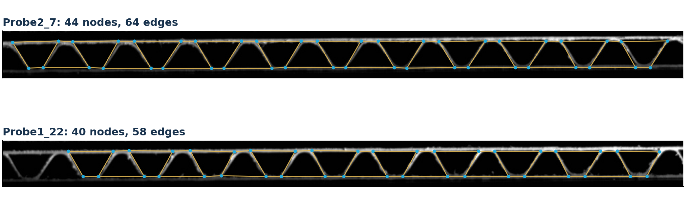
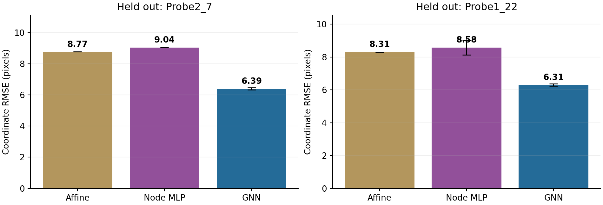

# GNN-CB

A trained **graph neural surrogate for corrugated-board deformation**, built from the original camera-derived skeleton graphs and tracked node positions in the corrugated-board compression research.

**Task:** initial graph + prescribed compression-protocol phase → displacement of every initial node. This is a supervised, phase-conditioned deformation surrogate. The phase uses the source author's offline annotations; it is not measured strain or an autonomous time forecast. The image-to-graph extraction comes from the original study; this repository imports and validates those graphs and trains the predictor.



## Recorded result

Two leave-one-specimen-out directions, three fixed seeds (11, 29, 47), no test-specimen labels used for training or epoch selection. Coordinate RMSE averages x/y squared errors over observed node-frames; the table gives the unweighted mean of the two specimen RMSE values.

| Model | Macro RMSE (pixels) |
|---|---:|
| Zero displacement | 12.434 |
| Quadratic-phase affine geometry model | 8.539 |
| Node MLP, no graph edges | 8.810 ± 0.219 |
| **GNN with three message-passing rounds** | **6.351 ± 0.063** |

The GNN reduces this error by **25.6%** relative to the affine model. The ± values describe optimizer-seed variability, **not** confidence intervals over materials or specimens. Horizontal prediction improves substantially; vertical error remains around 2.6–2.7 pixels. The two specimens have similar cross-sections: this is a feasibility result, not evidence of broad material/topology generalization.



## Run the existing model

Python 3.10+ and CPU are sufficient. Prepared data and trained checkpoints are included, so downloading the raw archives is optional for this first command.

```bash
python -m venv .venv
# Linux/macOS: source .venv/bin/activate
# Windows PowerShell: .venv\Scripts\Activate.ps1
python -m pip install torch --index-url https://download.pytorch.org/whl/cpu
python -m pip install -r requirements.txt
python -m gnn_cb.predict --checkpoint results/loso/train_Probe1_22__test_Probe2_7/gnn_seed11.pt --graph data/processed/Probe2_7.npz --phase 0 0.25 0.5 0.75 1 --output results/my_prediction.npz
```

The command writes both NPZ and human-readable CSV with predicted displacements/positions in pixels. Inference reads **only initial geometry and topology**, not target trajectories or future images. For another graph, create a numeric NPZ containing `x0 [N,2]`, `edge_index [2,E]`, `initial_pos_px [N,2]`, unique integer `node_ids [N]`, and positive `scale_px`. Use the same conventions: x right, y down, `scale_px = initial vertical graph extent`, and `x0 = (initial_pos_px - coordinate minima) / scale_px`. Generalization outside the two study specimens remains unvalidated.

## Reproduce data and benchmark

```bash
# Download the original public archives at the pinned source commit and verify SHA-256.
python scripts/prepare_data.py --download
# Or import archives already in a local clone:
# python scripts/prepare_data.py --source-dir ../Graphs_Analysis_Corrugated_Boards

python -m gnn_cb.train --epochs 600 --patience 150 --seeds 11 29 47 --threads 2
python -m unittest discover -s tests -v
python scripts/plot_data.py
python scripts/plot_results.py
python scripts/build_report.py
```

`requirements-tested.txt` and `reports/environment.json` record the actual environment. The frozen source is [Graphs_Analysis_Corrugated_Boards @ 16eed74](https://github.com/ricardofitas/Graphs_Analysis_Corrugated_Boards/tree/16eed74ff025e0e0f40f4f5d81c2b71af58b93b5). Archive hashes are in `gnn_cb/data.py` and the committed manifest. Source data use the MIT license retained in `licenses/source-data-MIT.txt`.

## What the data support

| Specimen | Initial nodes / undirected edges | Camera frames | Compression frames | Observed target coverage |
|---|---:|---:|---:|---:|
| Probe2_7 (Ex1) | 44 / 64 | 205 | 33–158 | 99.964% |
| Probe1_22 (Ex2) | 40 / 58 | 205 | 40–164 | 98.040% |

There are **two independent specimens**, with 10,444 observed node-frame displacement labels in the compression windows. Missing observations are masked, never interpolated. Targets are automated image-tracking measurements, not independent DIC/FEM truth. The original node graph and tracking spreadsheets are matched exactly; newer CSV node numbering is not silently mixed with them.

Other exports in `Graph-CB` cover five experiments, but contain duplicate versions and missing original geometry/images. They were audited and excluded rather than given invented coordinates or force labels. `reports/DATA_AUDIT.md` documents every exclusion.

## Model and evaluation

- Initial xy coordinates preserve aspect ratio and are normalized by the initial graph height. Neural spatial features are centered.
- Node encoder → three edge-conditioned message-passing blocks → two displacement outputs. Each edge carries initial relative dx, dy and distance; incoming messages use a degree-normalized mean.
- A training-only affine model provides the base displacement field. The neural model learns its residual. The node MLP uses the same base field and phase/geometry inputs without graph messages.
- GNN: 21,634 trainable parameters. MLP: 22,570. AdamW, learning rate 0.002, weight decay 0.001, masked coordinate MSE, gradient clipping 5.
- Outer folds hold out an entire specimen. On the training specimen: phase 0–0.75 fits parameters; (0.75,0.80) is purged; 0.80–1.00 selects the epoch. All models use this same split. No refitting on validation is performed for benchmark checkpoints.
- Test metrics cover phase 0–1 and separately the fit-phase support / late interval. Late test results therefore combine specimen transfer and phase extrapolation. Three seeds measure optimization variation only.
- Source compression phase already uses the annotated end of the recorded experiment. This retrospective protocol information must not be interpreted as causally available online.

Complete-track sensitivity retains 42 nodes in Probe2_7 and 15 in Probe1_22: GNN RMSE 6.245 and 6.317 pixels, respectively. Mean endpoint error remains around 8 pixels (~20% of initial height), so meaningful local errors remain.

A demonstration checkpoint in `results/final/model.pt` is fitted to both full compression windows for 198 epochs (the rounded median of source-validation-selected GNN epoch counts). It has no independent test claim; use the LOSO checkpoints for the reported benchmark. `results/final/metadata.json` records its exact settings.

See `results/loso/metrics.json`, per-fold checkpoints, training histories, numeric predictions, and `reports/GNN_CB_Approach_Report.pdf` for recorded results. Figures comparing shapes average the three seed predictions; the main benchmark table averages seed-level RMSE, which is a different statistic.

## Scope and next steps

The model predicts 2D nodal displacement. It does not currently predict force, stress, constitutive parameters, damage, failure probability, or changing topology. It does not impose force balance, contact, material laws, or boundary conditions. Tracking quality and missing nodes can limit accuracy, particularly at final collapse.

The next useful data are additional independent specimens with raw image sequences, stable node identities, independent camera calibration, material/flute metadata, and synchronized machine displacement/force. Those would support geometry/material-held-out validation and a physically controlled displacement input. A coupled force head should be introduced only after the alignment is verified.

## Research attribution

Belfekih, T.; Fitas, R.; Schaffrath, H.-J.; Schabel, S. **Graph-Based Analysis for the Characterization of Corrugated Board Compression.** *Materials* 2024, 17(24), 6083. [doi:10.3390/ma17246083](https://doi.org/10.3390/ma17246083).

The message-passing design is inspired by graph-network physical surrogates, including Pfaff et al., **Learning Mesh-Based Simulation with Graph Networks**, ICLR 2021, [arXiv:2010.03409](https://arxiv.org/abs/2010.03409). This implementation is a small original conditional-regression model, not a reproduction of MeshGraphNets' simulation results.
