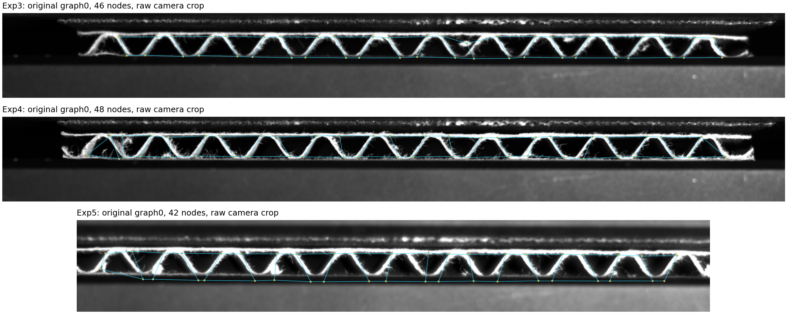

# GNN-CB

A trained **graph neural surrogate for corrugated-board deformation**, with audited experimental graphs, an image-to-graph curation pipeline, trained checkpoints and reproducible evaluation.

**Task:** initial graph + supplied compression-protocol phase → displacement of every initial node. The model predicts image-derived 2D displacement. Phase is retrospective protocol information; it is not calibrated strain or an autonomous forecast.

The current primary benchmark uses **five physical specimens**, expanded from the original two. Four further camera recordings were recovered and processed into graphs and masked tracks; their quality qualification and supplementary experiments are kept distinct from the fixed five-specimen benchmark.

[Read the approach report](reports/GNN_CB_Approach_Report.pdf) · [Expanded data audit](reports/EXPANDED_DATA_AUDIT.md) · [Recorded benchmark](results/expanded/five_specimens/metrics.json) · [Why augmentation regressed](reports/AUGMENTATION_DIAGNOSIS.md) · [More labels and statistical evidence](reports/DERIVED_SUPERVISION_AND_SIGNIFICANCE.md)



## Current result: five physical specimens

Five leave-one-physical-specimen-out folds and three fixed seeds (11, 29, 47). Each fold fits **three specimens**, uses a separate **whole specimen for validation**, and reserves the fifth specimen for testing. All partitions cover phase 0–1; test labels are never used for epoch selection.

Coordinate RMSE averages x/y squared errors over observed node-frames. The primary score gives each test specimen equal weight and divides its error by its own initial graph height, so different camera resolutions do not determine the result.

| Model | Macro RMSE / initial height | Macro RMSE, pixels (secondary) |
|---|---:|---:|
| Zero displacement | 27.257% | 19.645 |
| Quadratic-phase affine geometry model | 16.462% | 11.506 |
| Node MLP, no graph messages | 16.520% ± 0.076 pp | 11.559 ± 0.073 |
| **GNN, three message-passing rounds** | **13.539% ± 0.357 pp** | **9.858 ± 0.299** |

The GNN's normalized error is **17.75% lower than the affine baseline**. Its seed-averaged error improves on that baseline in **all five held-out specimens**. The ± values describe optimizer-seed variability; they are not population confidence intervals. Five specimens and noisy automated tracking labels still provide limited evidence of broad material or topology generalization.

| Held-out specimen | Affine RMSE / height | GNN RMSE / height, seed mean |
|---|---:|---:|
| Exp3 / D12 | 12.976% | 11.827% |
| Exp4 / D14 | 15.477% | 14.362% |
| Exp5 / ID03 | 13.832% | 12.250% |
| Probe1_22 | 17.415% | 11.934% |
| Probe2_7 | 22.610% | 17.324% |

The fixed protocol, source dataset hashes, full metrics, histories, checkpoints and numerical predictions are under [`results/expanded/five_specimens`](results/expanded/five_specimens). These are experiments on recovered archived specimens, not a prospective locked external study.

## Run the trained model

Python 3.10+ and CPU are sufficient. Prepared datasets and checkpoints are included.

```bash
python -m venv .venv
# Activate .venv using your shell's activation command.
python -m pip install torch --index-url https://download.pytorch.org/whl/cpu
python -m pip install -r requirements.txt

python -m gnn_cb.predict \
  --checkpoint results/expanded/five_specimens/final/model.pt \
  --graph data/automatic/tracks/Probe1_9.npz \
  --phase 0 0.25 0.5 0.75 1 \
  --output results/my_prediction.npz
```

The command writes NPZ and CSV with predicted displacements and positions in pixels. Inference reads only `x0 [N,2]`, `edge_index [2,E]`, `initial_pos_px [N,2]`, unique integer `node_ids [N]` and positive `scale_px`. Coordinates use x right / y down, `scale_px` is the initial vertical graph extent, and `x0 = (initial_pos_px - coordinate minima) / scale_px`.

The demonstration checkpoint was fitted to all five benchmark specimens for **60 epochs**, using the median validation-selected epoch count. Its fitting error is not an independent evaluation; use the outer-fold results above for accuracy claims. The example camera graph was not among those five training specimens. Its caller-supplied phases are hypothetical, so phase 1 does not assert a true video endpoint.

### Verified geometry-only inference

```bash
PYTHONPATH=. python scripts/verify_automatic_geometry_inference.py
```

This constructs temporary NPZ files containing only the five initial-geometry fields, with no targets, masks or progress arrays. Predictions are bit-for-bit identical to inference from the full files, under an access guard that rejects every other array key.

| New recording | Initial nodes | Undirected edges | Requested phases |
|---|---:|---:|---|
| Probe1_2 | 105 | 151 | 0, 0.25, 0.5, 0.75, 1 |
| Probe1_8 | 106 | 154 | 0, 0.25, 0.5, 0.75, 1 |
| Probe1_9 | 50 | 69 | 0, 0.25, 0.5, 0.75, 1 |
| Probe1_10 | 48 | 67 | 0, 0.25, 0.5, 0.75, 1 |

All **1,545 node-phase predictions** are finite. Saved outputs and the access audit are in [`results/expanded/automatic_geometry_inference`](results/expanded/automatic_geometry_inference). This establishes executable inference on different graph sizes. It does not establish accuracy: Probe1_2 and Probe1_10 lack an observed complete compression endpoint, and Probe1_8 loses substantial tracking coverage near collapse. These are useful geometry stress tests, with accuracy claims requiring a separately qualified evaluation.

## Audited benchmark data

| Physical specimen | Nodes / undirected edges | Archived frames | Compression frames | Valid compression node observations | Coverage |
|---|---:|---:|---:|---:|---:|
| Probe2_7 | 44 / 64 | 205 | 126 | 5,542 | 99.96% |
| Probe1_22 | 40 / 58 | 205 | 125 | 4,902 | 98.04% |
| Exp3 / 2024-08-05 D12 | 46 / 67 | 174 | 95 | 2,566 | 58.72% |
| Exp4 / 2024-08-05 D14 | 48 / 71 | 185 | 126 | 5,403 | 89.34% |
| Exp5 / 2024-12-03 ID03 | 42 / 61 | 72 | 40 | 839 | 49.94% |
| **Total** | **220 / 321** | **841** | **512** | **19,252** | — |

The first two NPZ datasets remain byte-for-byte unchanged. The original import had excluded Exp3–Exp5 because newer CSV exports could not be reliably joined to initial geometry. The missing coherent bundles were subsequently located in the private `uncertain_cb` repository: original graphs, tracking workbooks, phase annotations and **431 original camera images**, all verified against source hashes.

Every included node's initial reference matches graph0, every recorded position matches the same node in the same archived graph frame, and the observed-event tracking chains agree exactly. Only explicit workbook matches become labels. Carried-forward graph positions do not. All members of duplicate-coordinate matches are masked: 447 observations across the new specimens, including 227 within compression. Missing values remain masked; no trajectories are interpolated.

Exp5 rate3/rate10 and repository path aliases are repeated versions of the same experiment. They never become extra independent specimens. The initial graphs and tracking labels remain automated image measurements, not independent DIC or FEM ground truth. Source consistency does not prove physical correspondence after buckling.

## Reproduce the five-specimen benchmark

The prepared data are sufficient for training:

```bash
python -m gnn_cb.train_expanded \
  --data data/expanded \
  --output results/expanded/five_specimens \
  --epochs 300 --patience 75 --seeds 11 29 47 --threads 2
python -m unittest discover -s tests -v
python scripts/build_report.py
```

To reconstruct prepared data from source archives:

```bash
# Original public pair, pinned and SHA-256 checked.
python scripts/prepare_data.py --download

# Restore this private source using your own authorized Git access.
git clone https://github.com/ricardofitas/uncertain_cb.git /path/to/uncertain_cb
git -C /path/to/uncertain_cb checkout 1df856a4f2c71378744d4a73e3cd958f6f6d7a71
PYTHONPATH=. python scripts/prepare_expanded.py --source-root /path/to/uncertain_cb
```

The importer defaults to the committed [`data/expanded/source_tree.json`](data/expanded/source_tree.json), containing exact source paths and blob hashes. It also accepts the source's `Taieb` directory directly. The restricted pickle parser permits only the reviewed NetworkX and NumPy data classes after hash verification. Detailed provenance is in [`reports/expanded_data_audit.json`](reports/expanded_data_audit.json); execution checks are in [`reports/expanded_import_verification.json`](reports/expanded_import_verification.json).

[`requirements-tested.txt`](requirements-tested.txt), [`reports/expanded_environment.json`](reports/expanded_environment.json) and benchmark metadata record the executed environment. Source access credentials and temporary download URLs are not stored in the repository. The original public archives retain their MIT attribution in `licenses/source-data-MIT.txt`; no broader license is asserted for private source material.

## Additional image and video curation

Four recordings from `ML_Corrugated_Boards` were recovered from **17 RAR volumes**. All four streams decode to exactly **2,048 frames each: 8,192 frames total**. Their compressed-volume, AVI and decoded-pixel checksums are pinned in [`reports/video_source_audit.json`](reports/video_source_audit.json).

```bash
git clone https://github.com/ricardofitas/ML_Corrugated_Boards.git /path/to/ML_Corrugated_Boards
git -C /path/to/ML_Corrugated_Boards checkout bec78551eac3c25e7b3c9cf76a0068d78103785f
python scripts/extract_rar_videos.py \
  --source-dir /path/to/ML_Corrugated_Boards/Data/Videos \
  --output-dir /path/to/decoded --decode
```

The restoration script requires `libarchive-c` and the system `libarchive` shared library. It verifies every source volume before extraction, accepts only the expected regular AVI member, verifies its hash, and optionally writes every decoded frame as lossless PNG. `--verify-only` checks restored archives/videos; `--decode-check` validates all pixels without saving PNGs. Raw video and full-resolution PNG collections are not duplicated into this repository.

The new image pipeline performs contrast-aware foreground cleanup, skeletonization, junction extraction and traced edge extraction. It uses one-to-one temporal node matching with distance and ambiguity checks and exports observation masks. It records graph geometry and edge polylines for every frame, plus selected overlays for review.

```bash
# Example: extract an independent image sequence without inventing phase labels.
python scripts/curate_images.py \
  --images /path/to/decoded/Probe1_9 --glob 'image*.png' \
  --specimen Probe1_9 --lineage-id ML2023_Probe1_9 \
  --threshold 20 --output data/recurated
```

Omitting `--compression-window` exports masked tracks under `tracks/` and withholds a phase-labelled training dataset. Validated sequence-index endpoints may be supplied explicitly. The four-recording manifest records the extraction settings; `scripts/audit_camera_curation.py` additionally estimates a retrospective image-height phase convention, reviews endpoint coverage and controls **exploratory** training admission. Its image-derived convention is not the original author's annotation or a synchronized force/strain measurement.

Full-frame graph archives, masked tracks, selected images and curation metadata are under [`data/automatic`](data/automatic). Reports distinguish complete, partially observed and right-censored sequences. Additional repository imagery was inventoried as well: static photographs can support graph-extraction checks, while optimization screenshots and repeated processing exports do not become experimental displacement labels.

To reproduce all four sequences using the supplied portable manifest, restore/decode the videos into `data/raw/videos`, then run:

```bash
python scripts/curate_images.py --manifest data/automatic/camera_manifest.json --output data/automatic
python scripts/audit_camera_curation.py --images data/raw/videos
python scripts/pack_graph_archive.py --split-bytes 3000000
```

Published graph archives are distributed as **11 immutable binary parts, each at most 3,000,000 bytes**, with per-part and complete-archive SHA256 checks in [`archive_parts_manifest.json`](data/automatic/graphs/archive_parts_manifest.json). Restore the four exact NPZ files after cloning; the script uses only Python's standard library and verifies every part and complete archive before replacing a destination:

```bash
python scripts/restore_graph_archives.py
# Check parts and any restored files without changing the archives:
python scripts/restore_graph_archives.py --verify-only
```

The reconstructed archives use numeric `ragged_material_graph_v1` NPZ format, with `allow_pickle=False`. Frame offsets index node coordinates and edges; edge offsets index a stream of indices into a shared float64 polyline-point table. Metadata is retained as UTF-8 bytes. All **8,192 frame graphs** were checked by exact full-record round trips; byte-part restoration additionally reproduces each verified NPZ hash. Full NPZ and JSONL.gz files are local reconstruction intermediates; the repository stores their complete binary parts. To split existing verified NPZ files without repeating graph extraction, run `python scripts/pack_graph_archive.py --split-only --split-bytes 3000000`. Read one restored frame with:

```python
import numpy as np
from scripts.pack_graph_archive import unpack_frame

with np.load("data/automatic/graphs/Probe1_9.npz", allow_pickle=False) as archive:
    arrays = {key: archive[key] for key in archive.files}
frame0 = unpack_frame(arrays, 0)
```

### Frozen model on all eligible camera frames

The final five-specimen checkpoint was also evaluated, without fitting or selection, against **all eligible raw loading frames** from Probe1_8 and Probe1_9. This uses frame stride 1 rather than the stride-10 sampling used for exploratory training.

| Automatic trajectory | Eligible raw frames | Node-frame pseudo-targets | Frozen GNN RMSE / height | RMSE, pixels |
|---|---:|---:|---:|---:|
| Probe1_8, partial loading | 1,105 | 91,270 | 12.859% | 10.801 |
| Probe1_9, full loading window | 1,028 | 46,902 | 16.051% | 8.146 |
| **Total / equal-specimen mean** | **2,133** | **138,172** | **14.455%** | **9.474** |

| Frozen comparison on the same qualified observations | Macro RMSE / height | Macro RMSE, pixels |
|---|---:|---:|
| Zero displacement | 13.669% | 8.620 |
| Checkpoint's unchanged affine component | 13.930% | 8.791 |
| GNN | 14.455% | 9.474 |

**The GNN does not beat these baselines overall on the new automatic trajectories.** It improves on both for Probe1_9 and deteriorates for Probe1_8. The affine coefficients come from the same frozen checkpoint; no baseline was refitted on camera labels. Variance-weighted GNN R² is negative for both trajectories (−1.843 and −0.449), so broader transfer remains unestablished.

These scores measure **agreement with automated image pseudo-targets**, not independently calibrated physical accuracy. Probe1_8's phase keeps the full [136,1474] window; observations after raw frame1246 and all frames below the quality gate remain masked. Its unsupported collapse interval is not compressed into a shorter phase axis.

```bash
PYTHONPATH=. python scripts/evaluate_full_camera_tracks.py
```

[Metrics and complete eligible-window predictions](results/expanded/automatic_external) record the unchanged checkpoint hash, original frame indices, target masks and phase convention. These recordings were outside that checkpoint's fitting set; separately augmented models cannot claim this score as their own held-out accuracy.

### Supplementary augmentation: seven available specimens, the same five tests

Added `ML2023_Probe1_8` and `ML2023_Probe1_9` only to the fitting partition of each original fold. Test/validation specimens, seeds and optimization settings remain exactly those of the five-specimen reference protocol. Both variants ran 30 neural fits. The combined dataset contains **7 physical specimens, 1,080 stored states, 751 compression states (727 supervised), 33,168 valid node-frame targets, 376 initial nodes and 544 edges**. Held-out evaluation still covers five physical specimens.

Probe1_9 contributes 104 supervised sampled frames and 4,745 observations. Probe1_8 contributes 111 supervised sampled frames and 9,171 observations before tracking deteriorates; late targets are masked while the full-window phase is preserved. Its usable supervision stops at phase 0.8296. Probe1_2 and Probe1_10 remain withheld because their compression endpoints are unobserved.

| Model | Five-specimen reference | With two additional training videos |
|---|---:|---:|
| GNN | 13.539% ± 0.357 pp | 13.898% ± 0.177 pp |
| Affine | 16.462% | 16.516% |
| MLP | 16.520% ± 0.076 pp | 16.541% ± 0.015 pp |

**The extra data did not improve aggregate accuracy:** GNN error increased by **0.359 percentage points / 2.65% relative** on the same held-out experiments. Different geometry, tracking quality and phase conventions are plausible contributors, but this experiment does not isolate their causes. The five-specimen checkpoint remains the documented reference; both benchmark variants and demonstration checkpoints are retained. More image files alone are not evidence of improved generalization.

```bash
python -m gnn_cb.train_expanded \
  --data data/expanded \
  --augmentation-data data/automatic/training \
  --augmentation-specimens Probe1_8 Probe1_9 \
  --reference-protocol results/expanded/five_specimens/protocol.json \
  --output results/expanded/seven_specimens_fixed_tests \
  --epochs 300 --patience 75 --seeds 11 29 47 --threads 2
```

[Paired fixed-test comparison](results/expanded/fixed_test_comparison.json) and [complete results](results/expanded/seven_specimens_fixed_tests/metrics.json) preserve the numerical outcome. The new video labels are automatic pseudo-targets; no independent DIC or calibrated mechanical validation is implied.

## Controlled diagnosis of the augmentation regression

A follow-up investigation runs **14 prespecified exploratory variants × 5 fixed
test specimens × 3 seeds = 210 GNN fits**. All original test/validation identities,
test masks and primary scoring remain fixed. The original augmented predictions
were reproduced bit-for-bit in all 15 fold/seed combinations.

The evidence supports a change in the fitted domain mixture and predicted field
biases: the new videos have smaller observed displacement amplitudes and positive
mean horizontal motion, while four primary specimens have negative mean horizontal
motion. About **88.3% of Exp5's increased MSE** is in the per-frame mean-error
component. This is an error decomposition, not proof of camera motion or tracking
error.

| Diagnostic intervention | Fixed-test GNN RMSE / height | Seed SD (pp) |
|---|---:|---:|
| Original five-specimen benchmark, unchanged | **13.539%** | 0.357 |
| Both training videos, total loss weight 40% | 13.898% | 0.177 |
| Both videos, total loss weight reduced to 14.286% | 13.360% | 0.334 |
| Video-only phase sensitivity: `p − 0.4 p(1−p)` | 13.327% | 0.718 |
| Strict observed-jump filter | 14.239% | 0.167 |
| Matched observation-removal control | 13.809% | 0.371 |

Seed SD describes optimizer variability, not a population confidence interval.
The negative phase warp has particularly high seed variability.

Reduced video weight improves all three seed means relative to the augmented
control, but still trades performance between specimens. The phase transformation
is **not** an independently calibrated correction. The tested tracking filter
worsens agreement compared with the matched-removal control. No inconsistent
coordinate normalization or masked-value leakage was found.

**These are diagnostic results, not replacement benchmark or deployment claims.**
The five-specimen checkpoint remains the reference; no pseudo-label is treated as
an independent physical measurement. Full results include unfavorable outcomes,
existing affine/MLP baselines, phase and observation sensitivities, no-edge
controls, source fingerprints, loss histories, and reproducible commands.

[Scientific diagnosis](reports/AUGMENTATION_DIAGNOSIS.md) ·
[All quantitative ablations](results/diagnosis/ablation_table.csv) ·
[Protocol](results/diagnosis/protocol.json) ·
[Verification](results/diagnosis/verification.json)

## More supervision from the same observations

A second registered exploratory study runs **9 arms × 5 unchanged tests × 3
seeds = 135 fits**. It derives temporal displacement differences and relative
edge displacement targets only from observed endpoints. The five original
specimens provide **1,125,113 absolute/derived vector relationships**, versus
19,252 absolute observations (**58.44×**). These correlated relationships add
**zero independent physical measurements**; missing trajectories stay masked.

| Original-task comparison | RMSE / initial height | Paired nominal p vs corresponding control |
|---|---:|---:|
| Original GNN, exact replay | **13.539302%** | — |
| GNN with temporal + edge difference objectives | 13.411865% | 0.4375 |
| GNN with Monte Carlo geometry input noise | 13.586782% | 0.5000 |
| Original three-seed prediction ensemble | 13.253484% | — |
| Global-readout + joint-objective three-seed ensemble | 12.930042% | 0.3750 |

The joint objective reduces mean error by **0.127437 pp (0.941236% relative)**,
improving four of five specimen scores. Its conditional case-bootstrap interval
for the difference is **[−0.340430, +0.192766] pp**. The exploratory ensemble
reduces error by **0.323442 pp (2.440433%)** against the original ensemble;
its interval also crosses zero. Equal prediction averaging uses three models
from the same held-out fold, and is distinct from averaging seed RMSEs.

**Neither reduction establishes statistical significance.** Every new-arm and
ensemble Holm-adjusted p-value is 1.0. Tests use five paired physical specimens,
not independent frames, target pairs or optimizer seeds. Shared LOSO training
sets leave the sign-flip assumptions unverified; reported p-values and empirical
case-bootstrap intervals are sensitivity statistics, not population guarantees.
The previously reported lower-video-weight result also lacks significance
against the original GNN (nominal p = 0.875).

This study tests Monte Carlo graph input noise, not a generative image model.
Generated appearance alone cannot supply validated physical displacement labels.
The report specifies how simulation-labelled or correspondence-preserving images
could support a separate future experiment. The primary benchmark, original
models, source data and earlier results remain unchanged. All **59 integrity
tests pass**; all **135 checkpoint predictions** are reproduced bit-for-bit.

[Scientific follow-up](reports/DERIVED_SUPERVISION_AND_SIGNIFICANCE.md) ·
[All nine arms](results/derived_supervision/comparison.csv) ·
[Statistical analysis](results/derived_supervision/statistics.json) ·
[Frozen protocol](results/derived_supervision/protocol.json) ·
[Verification](results/derived_supervision/verification.json)

## Model and evaluation details

- Initial xy coordinates preserve aspect ratio and are normalized by initial graph height; neural spatial features are centered.
- A node encoder, three edge-conditioned message-passing blocks and a decoder produce two displacement components. Edge inputs are initial relative dx, dy and distance; incoming messages use a degree-normalized mean.
- A training-only weighted affine fit supplies the base field. The neural network learns its residual. The comparison MLP uses the same geometry and phase inputs without graph messages.
- GNN: 21,634 trainable parameters. MLP: 22,570. AdamW, learning rate 0.002, weight decay 0.001, masked normalized-coordinate MSE and gradient clipping 5.
- The expanded protocol weights physical specimens equally. A separate whole validation specimen selects the epoch, including epoch zero; an entire different specimen is reserved for testing. Aliases and re-extractions stay in their physical-specimen group.
- Phase 0–1 is available in all expanded partitions. The retrospective phase already uses an annotated endpoint and is not assumed causally available online.

## Historical two-specimen pilot

The original experiment remains reproducible under `data/processed`, `results/loso` and `results/final`. It reported **6.351 px GNN RMSE**, compared with **8.539 px affine RMSE** (25.6% reduction), for only two similar specimens. Its validation split used a later temporal interval within the training specimen. Those values are **historical pilot results**, not the current five-specimen score; the camera resolutions and validation protocol differ.

```bash
python -m gnn_cb.train --epochs 600 --patience 150 --seeds 11 29 47 --threads 2
python scripts/build_pilot_report.py
```

[`reports/DATA_AUDIT.md`](reports/DATA_AUDIT.md) records the pilot's original exclusions. The current audit supersedes the Exp3–Exp5 availability conclusion because their original coherent bundles have now been recovered. `scripts/build_report.py` builds the expanded approach report; the pilot builder is separate.

## Scope

The model predicts 2D nodal displacement. Force, stress, material laws, damage, contact and changing topology are not prediction outputs. The model does not enforce equilibrium or constitutive physics. Tracking failure and node merging remain material limitations near collapse, and increasing frame count does not increase the number of independent experiments.

Further scientific validation needs additional physical specimens, reviewed node correspondence, camera calibration, material/flute metadata and independently synchronized machine displacement/force. A force prediction head requires that synchronization first.

## Research attribution

Belfekih, T.; Fitas, R.; Schaffrath, H.-J.; Schabel, S. **Graph-Based Analysis for the Characterization of Corrugated Board Compression.** *Materials* 2024, 17(24), 6083. [doi:10.3390/ma17246083](https://doi.org/10.3390/ma17246083).

The message-passing design is inspired by graph-network physical surrogates, including Pfaff et al., **Learning Mesh-Based Simulation with Graph Networks**, ICLR 2021, [arXiv:2010.03409](https://arxiv.org/abs/2010.03409). This implementation is an original small conditional-regression model, not a reproduction of MeshGraphNets' simulation results.
