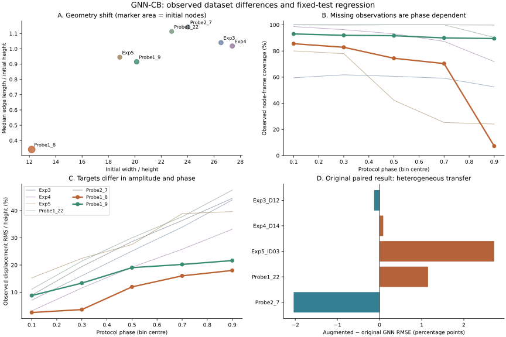
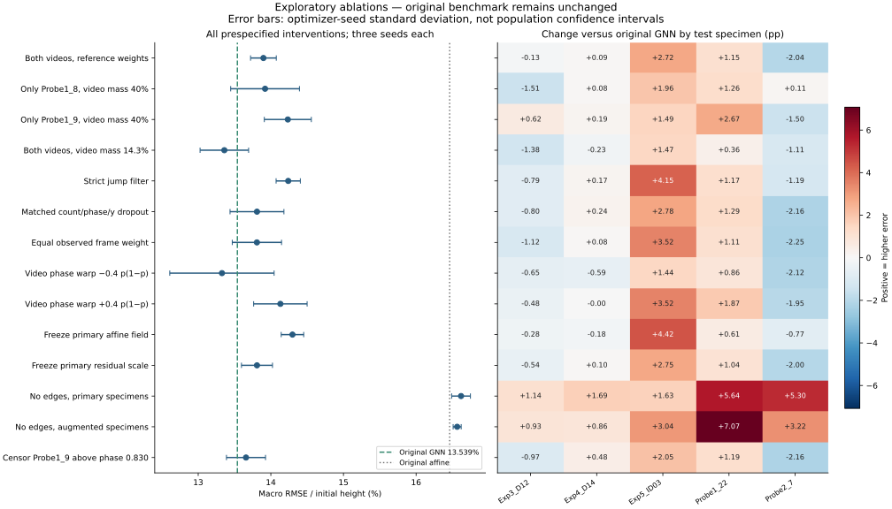

# Why did more data worsen GNN-CB? A controlled, fixed-test diagnosis

Study initiated 2026-10-09. Source snapshot: `8b0f2a2c9ff8a971d4b7349163b8306495ed74ac`.

This is an exploratory diagnosis of an already inspected benchmark, not a new
confirmatory benchmark. The original five-specimen result and both original
checkpoint collections remain unchanged. Camera tracking targets are automated
image pseudo-labels, not independent physical displacement measurements.

The strongest evidence concerns the **weight and response conventions of the
training mixture**, not a normalization bug. Reducing the new videos' combined
loss weight lowers fixed-test error from 13.898% to 13.360%; a prespecified
training-video phase perturbation gives 13.327%, without establishing a physically
correct phase convention. A stricter tracking filter instead worsens error.
The observed regression mainly concerns common prediction biases: 88.3% of
Exp5's added MSE lies in its per-frame mean-error component. Physical causes
remain incompletely identified and no exploratory model replaces the reference.

## Question and experimental unit

The observed change was **13.539302% → 13.897997%** coordinate RMSE divided by
initial graph height: **+0.358695 percentage points, +2.649288% relative**.
“Five versus seven specimens” describes total availability. An original fold
fits **three** primary specimens, validates on one whole different specimen,
and tests on the remaining specimen. Augmentation fits those same three plus
two camera specimens; validation and testing do not change.

There are five physical test specimens, not thousands of independent nodes,
frames, three independent populations, or 210 independent experiments. Outer
folds share training specimens; optimizer seeds quantify optimizer variability.

## Controls and reproducibility

All fourteen new intervention definitions and thresholds were written to
[`protocol.json`](../results/diagnosis/protocol.json) before their new fits.
The protocol pins input SHA-256 values and the runner's code hash. The local
registration was committed before results; its remote registration commit is
`50e037fa031c7525ee035a5f87552aac1f02faf6`. This is a post-hoc investigation of the
known original regression, not formal prospective preregistration.

Every intervention uses the original cyclic whole-specimen validation mapping,
seeds 11, 29, 47, maximum 300 epochs, patience 75, validation every 5 epochs,
AdamW learning rate 0.002, weight decay 0.001, and gradient clipping at 5.
Epoch zero remains eligible. Normalized test coordinate RMSE uses exactly the
original observations and equal weight per physical test specimen. No test
label enters fitting, affine coefficients, residual scaling, or epoch selection.
Validation/test phases and masks are never changed. Model inputs remain initial
geometry, initial connectivity, and supplied protocol phase.

All declared arms are reported, including unfavorable outcomes. No winning arm
is substituted for the original benchmark or all-data demonstration checkpoint.
Choosing a deployment model from this exploratory table would require a fresh
untouched evaluation. The original archived tests are now repeatedly inspected
diagnostic cases, even though their labels never drive gradients or selection.

The original augmented run is replayed first. A secondary epoch control uses
the **original validation-selected epoch of the same fold and seed**, not a
new epoch chosen from its test score. If that epoch lies beyond the augmented
run's stopping time, optimization continues solely to capture the secondary
probe; the original augmented selection remains closed and unchanged.

## Input audit: observations, geometry and normalization

The read-only audit is [`input_audit.json`](../results/diagnosis/input_audit.json).
It records source hashes, observation coverage by phase and initial vertical
third, initial graph statistics, per-coordinate errors and original paired
seed results. No observation is interpolated or filled forward.

| Specimen | Nodes | Width / height | Median edge / height | Observed coverage | Observed displacement RMS / height |
|---|---:|---:|---:|---:|---:|
| Exp3 / D12 | 46 | 26.538 | 1.041 | 58.72% | 27.796% |
| Exp4 / D14 | 48 | 27.390 | 1.018 | 89.34% | 20.473% |
| Exp5 / ID03 | 42 | 18.857 | 0.945 | 49.94% | 25.813% |
| Probe1_22 | 40 | 22.795 | 1.113 | 98.04% | 31.793% |
| Probe2_7 | 44 | 24.024 | 1.142 | 99.96% | 30.412% |
| Probe1_8 | 106 | 12.179 | 0.342 | 64.09% | 10.112% |
| Probe1_9 | 50 | 20.138 | 0.915 | 91.25% | 17.228% |

Coverage and RMS here concern the stored training samples, including the
masked part of each full loading window. They are descriptive label statistics;
they are not calibration measurements or prediction accuracy.

**A measurable domain shift exists.** Probe1_8 has a visibly multi-layer graph,
more than twice as many nodes, substantially shorter normalized edges, and
middle-height nodes unlike almost all original specimens. Explicit three-hop
message neighborhoods cover on average 14.4% of its nodes versus 23.5–27.8%
in the original graphs. The model also receives centered coordinates and an
affine field, so this neighborhood statistic is not its entire information
content. It does not by itself prove insufficient message depth.

The observed RMS displacement of each video is smaller than that of every
primary specimen. This comparison is also affected by which nodes survive and
by phase coverage; it is not proof of a different constitutive response.
Geometry, acquisition protocol, extraction procedure, and target distribution
change together. This dataset cannot uniquely identify their separate physical
causal contributions.

**The horizontal target distribution also changes sign.** Mean observed `dx`
is −5.40%, −6.41%, −7.71%, and −4.67% of height for Exp3, Exp4, Exp5 and
Probe1_22, but +12.76% for Probe2_7. The videos have +3.73% and +10.24%.
These are image-coordinate statistics over observed nodes, not independently
measured physical translation. After augmentation the mean horizontal prediction
error shifts positively in **every** test specimen (about +3.2 to +5.1 pp).
Vertical prediction bias shifts downward by about 1.6–5.9 pp. This helps some
pre-existing biases and worsens others.

**Normalization is internally consistent.** Reconstructing all seven `x0`
arrays from initial pixel coordinates and graph height, and every observed `y`
from stored pixel displacement and that same height, gives zero maximum
absolute discrepancy in the committed arrays. Scale is the initial graph's
vertical extent. Affine fitting and residual scaling use fitting specimens
only. Thus no inconsistent unit conversion or masked-placeholder contamination
was found. This does not establish camera calibration or physical similitude.

**Phase is not strain.** Original phases use archived author annotations; the
new videos use an image-front loading/rebound convention. Displacement is
relative to frame 0, not necessarily the frame at phase 0. RMS displacement at
the first supervised compression phase ranges from 0.747% (Exp4) to 12.067%
(Exp5); it is 2.030% and 5.689% for Probe1_8 and Probe1_9. Forcing zero displacement
at phase 0, or re-zeroing test labels using their observed motion, would change
the task and can introduce target-derived information. Neither is done here.

**Missingness is structured.** Probe1_8 contributes 9,171 observations through
phase 0.829596; the remainder stays masked on its true full-window phase axis.
Only 2.3% of its supervised node-frame mass lies in phase 0.8–1, versus about
20% for a fully covered uniformly sampled window. Its observation-weighted
mean phase is 0.391. Exp5 is more incomplete overall and has mean observed
phase 0.359. Exp3's initial upper third contains 80.9% of its observed target
mass despite both upper and lower material being present. Missing labels cannot
be assumed to be randomly distributed.

**More frames did not automatically increase a specimen's weight.** The
original loss is a mean over observed coordinates within each specimen, then
a mean across physical specimens. Adding two equally weighted specimens changes
the original training group's mass from 100% to 60%; the two videos receive 20%
each. Within a specimen, frames with more surviving nodes contribute more.
An unobserved all-false frame contributes no zero target. Equal-frame weighting
cannot restore entirely absent late-phase observations.



## Intervention definitions

- **Single video, fixed 40% total video mass:** keep either Probe1_8 or Probe1_9;
  the three primary fitting specimens retain 20% each. This isolates mixture
  composition at fixed domain mass. It is deliberately not the usual 25%-each
  four-specimen fit, which would also change total video weight.
- **Reduced video mass:** both videos remain, each at 1/14 of loss, total 1/7
  (14.286%); the primary group receives 6/7. The same weights apply to affine
  fitting, residual loss and training-derived residual scaling.
- **Strict jump filter:** using raw-frame tracking, permanently stop each
  trajectory after its first observed matching distance above 10% of median
  initial edge length. This retains 8,290/9,171 and 4,422/4,745 observations.
  It is a heuristic; rapid real motion can also fail it. The distance is from
  the previous accepted match and may span a short tracking gap.
- **Matched dropout:** preserve the strict filter's exact observation count in
  each sampled frame and initial vertical third, but select surviving identities
  randomly with mask seed 20261009. This controls amount, phase and coarse
  vertical support. It does not control longitudinal continuity or prove which
  individual tracks are correct; only one mask realization is used.
- **Equal observed-frame weighting:** average each nonempty frame's coordinate
  MSE, then frames, then specimens, in **all fitting specimens**. Affine weights
  change consistently. Validation and test scoring remain original.
- **Phase sensitivity in both training videos:** replace `p` by
  `p ± 0.4 p(1−p)`. Both endpoints and ordering are preserved; the maximum
  change is 0.1 phase units. Labels and masks remain fixed. Neither direction
  is claimed to be the physically correct alignment.
- **Primary affine:** keep the analytic field fitted to the original three
  fitting specimens, while fitting neural residuals on the augmented mixture.
  Residual scale is then recomputed in the usual way, so this is an intervention
  on the affine fitting stage, not an additive causal decomposition.
- **Primary residual scale:** retain the augmented affine field and loss but
  use the residual scale computed from the primary-only fit. This tests changed
  optimization conditioning, not a pixel-unit conversion.
- **No edges, paired primary/augmented runs:** remove edges at fitting,
  validation and inference while retaining the same GNN modules. This removes
  message information; unused message parameters mean effective capacity is
  reduced even though nominal parameter count is unchanged. The original MLP
  remains a separate existing comparison.
- **Partial-trajectory control:** additionally censor Probe1_9 above the
  original Probe1_8 observed maximum phase, preserving phase values and all
  initial geometry. This tests loss of late supervision, not the correctness
  of an invented completion.

Simply applying the existing raw-gap continuity rule changes **none** of the
13,916 admitted video observations: the source tracker already restricts
reactivation. The stricter jump ablation therefore tests an additional criterion.
No pseudo-label is promoted to an independent measurement.

## Quantitative outcomes

All **210 new GNN fits** completed. Existing affine and MLP comparisons below retain their published training and tests. The 15 augmented control predictions, masks and selected epochs reproduce the published result exactly, including bitwise-identical full predictions.

| Existing model | Five-specimen reference | With two training videos |
|---|---:|---:|
| Zero displacement | 27.257% | 27.257% |
| Affine field | 16.462% | 16.516% |
| Node MLP | 16.520% ± 0.076 pp | 16.541% ± 0.015 pp |
| GNN | 13.539% ± 0.357 pp | 13.898% ± 0.177 pp |

Primary score is macro coordinate RMSE / initial height. The ± values throughout are SD across the three optimizer-seed macro scores, not confidence intervals over physical specimens.

| Fixed test specimen | Original GNN | Augmented GNN | Change (pp) |
|---|---:|---:|---:|
| Exp3_D12 | 11.827% | 11.698% | -0.129 |
| Exp4_D14 | 14.362% | 14.449% | +0.088 |
| Exp5_ID03 | 12.250% | 14.971% | +2.721 |
| Probe1_22 | 11.934% | 13.085% | +1.151 |
| Probe2_7 | 17.324% | 15.286% | -2.038 |

Paired macro changes across seeds 11, 29, 47 are **+0.687, −0.175 and +0.564 pp**. The original average deterioration is not consistent across all seeds. As a descriptive case sensitivity, excluding Exp5 from aggregation changes the remaining-four mean difference to **−0.232 pp**; excluding Probe2_7 changes it to **+0.958 pp**. These are sensitivity summaries, not replacement test sets or population inference.

| Registered diagnostic arm | GNN RMSE / height | Seed SD (pp) | Corresponding affine baseline | Δ vs original GNN (pp) |
|---|---:|---:|---:|---:|
| Both videos, reference weights | 13.898% | 0.177 | 16.516% | +0.359 |
| Only Probe1_8, video mass 40% | 13.921% | 0.473 | 16.371% | +0.381 |
| Only Probe1_9, video mass 40% | 14.234% | 0.324 | 16.820% | +0.695 |
| Both videos, video mass 14.3% | 13.360% | 0.334 | 16.327% | -0.179 |
| Strict jump filter | 14.239% | 0.167 | 16.504% | +0.700 |
| Matched count/phase/y dropout | 13.809% | 0.371 | 16.503% | +0.270 |
| Equal observed frame weight | 13.808% | 0.339 | 16.462% | +0.269 |
| Video phase warp −0.4 p(1−p) | 13.327% | 0.718 | 16.429% | -0.212 |
| Video phase warp +0.4 p(1−p) | 14.131% | 0.368 | 16.652% | +0.592 |
| Freeze primary affine field | 14.298% | 0.155 | 16.462% | +0.758 |
| Freeze primary residual scale | 13.809% | 0.214 | 16.516% | +0.270 |
| No edges, primary specimens | 16.619% | 0.129 | 16.462% | +3.080 |
| No edges, augmented specimens | 16.565% | 0.055 | 16.516% | +3.026 |
| Censor Probe1_9 above phase 0.830 | 13.658% | 0.269 | 16.489% | +0.119 |

The no-edge rows are message-ablation controls of the GNN, not the existing MLP. Single-video arms keep 40% total video loss weight. The affine baseline is refitted only on that arm’s fitting partition (except the deliberately frozen-primary-affine arm).



Numeric tables: [`ablation_table.csv`](../results/diagnosis/ablation_table.csv), [`summary.json`](../results/diagnosis/summary.json), and [`paired_comparisons.json`](../results/diagnosis/paired_comparisons.json). Each of the 210 records under [`runs`](../results/diagnosis/runs) contains loss histories, actual fitting weights, validation selection and phase-stratified test metrics.

### Frozen external camera evaluation remains separate

The unchanged five-specimen all-data demonstration checkpoint has macro error **14.455%** on the two qualified full-frame camera trajectories, compared with **13.669% zero displacement** and **13.930% for its unchanged affine component**. It improves on both baselines for Probe1_9 but loses on Probe1_8. Those scores use 2,133 eligible raw frames and 138,172 automatic node-frame targets; they measure pseudo-label agreement, not independently calibrated physical accuracy. Source: [`automatic_external/metrics.json`](../results/expanded/automatic_external/metrics.json).

No augmented model is described as independently tested on those same training videos. This evaluation is not recomputed on an exploratory winner, nor substituted for the fixed five-test benchmark.

## Mechanistic evidence and remaining uncertainty

The supplementary [`gradient_audit.json`](../results/diagnosis/gradient_audit.json)
uses fitting labels only at the fifteen original validation-selected GNNs.
Video8 versus primary-fit gradients have negative cosine in 10/15 cases
(median −0.075); Video9 does so in 7/15 (median +0.028). The combined videos
conflict locally in 8/15 (median −0.037), while their gradients align with each
other in all fifteen cases (median cosine 0.679). This is mixed evidence of
local objective tension, not a proof that a particular video causes population
test error. A local derivative at one checkpoint does not describe the full
nonlinear training trajectory.

### Exact error decomposition: common field bias versus relative node error

[`error_decomposition.json`](../results/diagnosis/error_decomposition.json)
decomposes the **unchanged** saved prediction error at each frame into its mean
over observed nodes plus its centered remainder. With observation-count weights,
MSE is exactly the sum of those two terms. This diagnostic uses test labels only
after prediction, never as an input or correction, and is not an alternative
headline benchmark.

| Test specimen | Change in total MSE | Change in frame-mean error term | Change in centered error term |
|---|---:|---:|---:|
| Exp3 / D12 | −3.118 | +22.395 | −25.513 |
| Exp4 / D14 | +2.458 | −0.912 | +3.370 |
| Exp5 / ID03 | +74.320 | +65.657 | +8.663 |
| Probe1_22 | +28.620 | +28.943 | −0.323 |
| Probe2_7 | −66.148 | −77.733 | +11.585 |
| Equal-specimen mean | **+7.227** | **+7.670** | **−0.443** |

Units are `(percent of initial height)²`; entries average MSE across the three
seeds, not squared seed-averaged RMSE. About **88.3% of Exp5's added MSE** is in
the per-frame common error term. Probe1_22's added error is also almost entirely
there. Probe2_7 improves because that term drops, although its centered error
rises. Across the five cases, the centered component slightly improves and the
common component explains the net MSE increase. This is direct numerical evidence
for a change in predicted field offsets/biases, rather than uniform deterioration
of every local deformation prediction.

The mean is over available nodes, not a mass-weighted physical centre. A common
error can arise from loading conventions, boundary motion, tracking, or camera
registration. This decomposition does **not** identify which physical source is
responsible and does not justify subtracting observed test motion at inference.

### What the controlled tests do and do not support

**Mixture weighting contributes on these fixed tests.** Reducing total video
mass from 40% to 14.286% lowers mean error from 13.898% to 13.360%, improving all
three paired seed means relative to the augmented control. Four specimens
improve relative to that control; Probe2_7 worsens. This is evidence of a
trade-off in the fitted mixture, not a claim that low weights will be optimal
for future specimens or for the new video domain. The original 13.539% benchmark
remains the reference even though this exploratory mean is slightly lower.

**Neither video is uniformly detrimental.** At the same 40% video mass,
Probe1_8 alone gives 13.921% and Probe1_9 alone 14.234%; their per-specimen
patterns differ. Both videos together are not simply a sum of these errors.
The source composition, nonlinear residual and validation selection interact.
A clean/dirty binary classification of the two videos is not justified.

**The tested jump filter is not a supported remedy.** It gives 14.239%, versus
13.809% for the removal control with matching phase/vertical-stratum counts.
Choosing which observations survive matters, but this heuristic selection
worsens the fixed-test mean. It might remove real motion, change informative
trajectory identities, or miss smooth tracking drift. It cannot establish
that the original pseudo-labels are physically correct or incorrect.

**Partial observation alone is not a sufficient explanation.** Censoring
Probe1_9 above phase 0.829596, without rescaling any phase, gives 13.658%, lower
than the 13.898% full-augmentation control. Losing more late labels therefore
does not monotonically worsen this benchmark. This does not show that missing
collapse trajectories are harmless: their accuracy remains unmeasured, and
observation/phase weighting changes with censoring.

**Changed stopping epochs are not the sole cause.** Reusing the original
validation-selected epochs for augmented training gives 14.020% overall.
Exp5 improves from 14.971% to 14.034% under that probe, but Probe1_22 worsens
from 13.085% to 14.966%. Selection dynamics mediate some individual outcomes;
restoring the previous epochs is not an aggregate cure.

**The graph branch is useful, but architectural sufficiency is unresolved.**
Removing edges gives 16.619% without videos and 16.565% with them, close to the
MLP/affine comparators and worse than the complete GNN. This argues against
abandoning messages as the explanation or fix. It does not test whether three
rounds, the lack of contact edges, unknown boundary conditions, or the absence
of loading/material metadata limit transfer.

**Phase sensitivity is demonstrated, but a correct phase is not identified.**
The negative warp gives 13.327%; the equally sized positive warp gives 14.131%,
versus 13.898% for unchanged video phase. These same-label, same-mask fits
establish sensitivity to the imposed phase convention. They cannot identify
physical strain or validate a particular alignment from test performance.
The negative warp has high optimizer-seed SD (0.718 pp) and slightly worsens
seed 11 relative to unchanged phase; the lower mean is not consistent superiority
over all seeds. The interventions were not chosen by searching these new test scores.

**Observation weights and numerical scaling have smaller effects here.**
Equal-frame loss gives 13.808%, while keeping the primary-only residual scale
gives 13.809%. Both remain above the 13.539% reference. Missingness-dependent
loss weights and optimization conditioning can alter outcomes, but neither
isolated intervention removes the observed regression against the original.
The exact coordinate/target normalization audit and masked-NaN tests still
provide no evidence of a unit-conversion or placeholder-leakage bug.

**Restoring the original affine component is not a cure.** Keeping the
primary-only affine field while learning on the augmented mixture gives
14.298%, worse than 13.898%. Thus the observed common-error shift cannot be
assigned solely to the analytic baseline: the baseline, residual network,
training-derived scale and validation selection interact. The MSE decomposition
identifies an error mode; it does not uniquely locate a faulty model block.

The most defensible conclusion is **domain-dependent transfer and sensitivity
to mixture weights/phase conventions on this fixed collection**. Neither bad
tracking as a physical cause, nor camera motion, incorrect strain alignment,
or a uniquely inadequate architecture has been demonstrated. Independent
correspondence and loading information are needed to separate those explanations.


## Next controlled scientific tests

1. Independently review material-point identity on a blinded sample stratified
   by specimen, phase, vertical region and jump size. Keep reviewer adjudication
   separate from model prediction error. Measure error rates against a genuinely
   independent reference before claiming that any tracking filter improves
   physical label accuracy.
2. Obtain synchronized commanded platen displacement and an initial camera
   calibration for new specimens. Define loading input before examining future
   trajectories. This can separate timing conventions from mechanical response;
   warping retrospective video phase alone cannot.
3. Acquire multiple independent specimens per geometry/acquisition domain,
   including complete collapse observations. In a prospective protocol, compare
   matched training sizes and matched phase support, crossed with geometry and
   source domain. With only two new videos, source identity and domain are
   confounded.
4. After choosing hyperparameters using nested training/validation only, compare
   three versus six message rounds and a global-geometry/domain-conditioning
   variant, crossed with primary versus augmented training. Keep optimization
   budget and baseline comparisons explicit. The no-edge control establishes
   the value of messages; it cannot establish adequate depth, contact modeling,
   or identifiable mechanics.
5. If an operational model is chosen from these explorations, evaluate it on
   new untouched physical specimens. Keep missing targets masked, report
   coverage alongside error, and retain the original published benchmark.

## Verification and preservation

All **45 integrity tests passed**, including the original ZIP-source audit,
masked-NaN invariance and held-out-label poisoning checks. All **210 cached
prediction sets** reproduce their recorded test RMSE exactly; one saved
checkpoint per arm was independently reloaded and its complete predictions
matched bit-for-bit. The published augmented control also reproduces all 15
original prediction arrays exactly. Full checkpoint metadata now lists actual
fitting membership, including videos, alongside the original primary split.

Of the **437 original repository files**, **434 remain byte-for-byte unchanged**.
The only modified originals are README, the historical-review scope notice and
cache ignore rules. Every original dataset, checkpoint, score, protocol and core
implementation is unchanged. [`verification.json`](../results/diagnosis/verification.json)
records these checks, environment versions and artifact hashes. Recorded fit
runtimes sum to 9,147 seconds across parallel jobs; this is a sum of per-fit
elapsed times, not end-to-end elapsed time or a CPU-hour measurement.

## Reproduction

From the repository root (CPU environment, no raw-video re-extraction required):

```bash
PYTHONPATH=. OPENBLAS_NUM_THREADS=1 OMP_NUM_THREADS=2 \
  python scripts/diagnose_augmentation.py --register-only
PYTHONPATH=. OPENBLAS_NUM_THREADS=1 OMP_NUM_THREADS=2 \
  python scripts/diagnose_augmentation.py --workers 3
PYTHONPATH=. OPENBLAS_NUM_THREADS=1 \
  python scripts/audit_augmentation_inputs.py
PYTHONPATH=. OPENBLAS_NUM_THREADS=1 OMP_NUM_THREADS=1 \
  python scripts/audit_augmentation_gradients.py
PYTHONPATH=. OPENBLAS_NUM_THREADS=1 \
  python scripts/decompose_prediction_errors.py
PYTHONPATH=. python scripts/diagnose_augmentation.py --summarize-only
PYTHONPATH=. python scripts/plot_augmentation_diagnosis.py
python -m unittest discover -s tests -v
```

After fitting, run `python scripts/verify_augmentation_diagnosis.py --finalize-checkpoints`. This finalizes cache provenance
from each run's actual fitting list, including the videos, and records before/
after hashes while checking that parameter tensors remain identical. It also
checks all cached masks, metrics and one checkpoint per arm. Raw fitting-split
metadata describes the primary specimens; use the finalized checkpoints when
inspecting full training membership. No-edge diagnostic checkpoints require
an empty `edge_index` at inference. These are not deployment checkpoints.

The runner rejects changed registered source/code hashes and resumes completed
runs only under the identical protocol. Each run records selected/completed
epochs, losses, fitting identities and weights, primary test source hash,
baselines, phase-stratified metrics, and numerical artifact hashes. The optional
`results/diagnosis/cache` contains newly generated checkpoints and full predictions;
it is a reproducible local cache rather than a replacement for any published
checkpoint. Delete only that diagnostic run's JSON entry to rerun it and
regenerate its cache. Original benchmark files must not be deleted or overwritten.

The ordinary test run skips the original ZIP re-import audit when source archives
are absent. Set `GNN_CB_SOURCE_DIR` to the authorized original two ZIP archives
to run that additional source audit. Execution environment and preservation
checks are recorded separately in `results/diagnosis/verification.json`.
