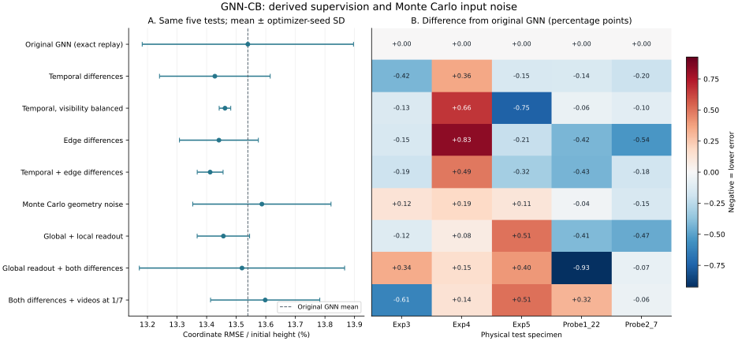
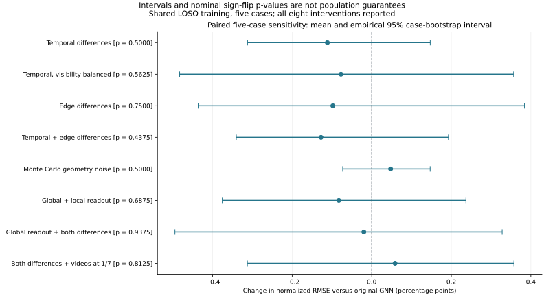

# More labels from the same data: derived supervision, Monte Carlo noise and uncertainty

Follow-up initiated 2026-10-10; source snapshot
`eba8d358de1e4b6a045c8c318bd2ddac7f7e9406`. The original **13.539302%**
five-specimen GNN benchmark remains unchanged. This study examines already
inspected archival tests and is exploratory, not prospective confirmation.

The same data support many more **derived training relationships**, and the
new joint temporal/edge objective lowers the original-task mean RMSE from
**13.539302% to 13.411865%**: **−0.127437 percentage points, −0.941236% relative**.
It improves four of the five seed-averaged specimen scores, but the paired
nominal p-value is **0.4375** (Holm-adjusted **1.0**). A significant population
improvement is **not established**.

A separately registered three-seed prediction ensemble reaches **12.930042%**
with global readout plus both objectives. Its like-for-like comparator is the
original three-seed ensemble at **13.253484%**: **−0.323442 pp, −2.440433% relative**,
nominal p = **0.375**, Holm-adjusted **1.0**. This is an exploratory ensemble
result with three-model inference, not a replacement for the original score.
The tested Monte Carlo input-noise intervention instead gives **13.586782%**.
All 135 fits and all outcomes are retained.

## What does “more labels” mean here?

For a physical specimen, let `u(t,i)` be the archived, normalized 2D displacement
of node `i` at protocol phase `t`, with observation mask `m(t,i)`. The original
predictor still receives only the initial geometry, connectivity and phase.
We add two supervised relationships:

1. **Temporal difference:** `u(t_b,i) - u(t_a,i)`, using every unordered pair of
   observed endpoints of the same archived node within the compression window.
2. **Spatial difference:** `u(t,j) - u(t,i)`, using each initial undirected edge
   once and only when both endpoints are observed at that frame.

Missing values never become targets; there is no forward filling, interpolation,
teacher prediction, new tracking admission, or phase recalibration. A temporal
pair can span an unobserved interval but labels only its two observed endpoints,
not the intervening path. It inherits any correspondence error in their node ID.
Temporal differences are **not divided by the phase interval**: they are neither
physical velocities nor strain-rate measurements. Edge differences are neither
measured stresses nor validated material strains.

Across the five original specimens, the data provide **19,252 absolute vector
targets**, **1,079,967 temporal difference vector targets**, and **25,894 spatial
difference vector targets**: **1,125,113 supervised vector relationships**, or
**58.44 times** the original count. These are dataset-wide counts, not the number
available for fitting in each fold. Each fold still fits only its three assigned
original specimens. Each vector contains two scalar coordinates.

The number of additional independent physical measurements is **zero**. For a
node with `k` observations, the `k(k−1)/2` temporal differences have linear rank
at most `k−1` per coordinate. Across these data the temporal incidence rank is
19,050 per coordinate, despite more than a million difference targets. Even this
algebraic rank is not a count of statistically independent observations.
[`label_inventory.json`](../results/derived_supervision/label_inventory.json)
records every specimen's counts.

The objectives change which errors optimization penalizes. They cannot create
unmeasured information about forces, material properties or missing trajectories.

## Controlled objectives and models

Let `L_node` be the original observed-coordinate MSE, `L_time` the mean squared
error in temporal differences, and `L_edge` the mean squared error in edge
differences. Auxiliary coefficients were fixed before new fitting:

```text
L = L_node + 0.5 × L_time / 2 + 0.5 × L_edge / 2
```

Single-objective arms omit the other auxiliary term. Division by two scales a
two-endpoint difference error; it is a chosen loss convention, not an assertion
that tracking noise is independent. Each auxiliary term is an average within
each specimen, so adding a million pairs does not multiply its total loss weight
by a million. Physical-specimen weights retain their registered values.

All temporal pairs are evaluated exactly in linear memory and time using
`sum(a<b) (e_a−e_b)^2 = k × sum(a) (e_a−mean(e))^2`, separately for each
node and coordinate. Tests compare both values and gradients against explicit
pair enumeration with masked NaNs.

More complete trajectories otherwise contribute quadratically more temporal
pairs. The **visibility-balanced** control gives each eligible node weight
proportional to its observed count `k`, instead of `k(k−1)/2`. Nodes with fewer
than two observations have no temporal pair, but retain their original absolute
supervision. Neither formulation recovers observations after tracking failure.

Temporal differences are blind to an error constant in time for each node;
spatial differences are blind to an error common to the connected nodes at a
frame. In particular, neither alone identifies a constant global translation.
The absolute loss remains necessary. This is an algebraic limitation verified
by an integrity test, not a conclusion drawn from the test-set outcomes.

The **global readout** arm retains three message-passing rounds and adds a
graph-wide residual predicted from the mean hidden state. The local residual
is centered over **all predicted nodes**, then combined with that global term.
No observed displacement, observation mask, or test-label mean is an inference
input. The original fit-only affine field remains in the predictor. This variant
has 22,756 parameters versus 21,634 in the original; its architecture comparison
also changes parameter count by 5.2%, so it is not a parameter-matched isolation
of global context. Both its decoders start at zero, preserving the affine model
at epoch zero.

The **Monte Carlo geometry-noise** arm draws one perturbed initial graph per
fitting specimen and optimizer update. Independent Gaussian node-coordinate
noise has standard deviation **0.005 initial graph height** (0.5%), is clipped
at three standard deviations before centering, and has its all-node mean removed.
Topology, normalization units, phases, displacement labels and masks stay fixed;
relative edge attributes follow the perturbed coordinates. The amplitude is a
declared measurement-error hypothesis, not an estimated camera calibration.
An independent fixed random stream preserves the original parameter initialization.
There is still one fitting forward pass per specimen and the same update limit.
Validation and inference use the unperturbed geometry. No synthetic image or
physical deformation is generated by this intervention.

## Fixed protocol and separation of specimens

Nine arms, five original leave-one-specimen-out folds and seeds **11, 29, 47**
produce **135 fits**. Every fold keeps the original whole validation specimen
and whole test specimen. The eight interventions are temporal pairs, balanced
temporal pairs, spatial pairs, both pairs, Monte Carlo input noise, global readout,
global readout with both pairs, and both pairs with admitted videos at total
weight 1/7. The ninth arm replays the original GNN as an exact control.

The last arm fits the same three primary specimens plus Probe1_8 and Probe1_9;
each primary receives weight 2/7 and each video 1/14. Its matched node-loss-only
control is the previously recorded `both_mass14` arm. The other new arms use
only the three original fitting specimens, each with weight 1/3. Probe1_2 and
Probe1_10 remain excluded. No video becomes an extra independent test case.

Maximum 300 epochs, patience 75, validation every five epochs, AdamW learning
rate 0.002, weight decay 0.001 and gradient clipping at 5 are unchanged. Epoch
zero is eligible. Only the original whole-validation-specimen **absolute node
MSE** selects epochs, including for the new objectives. Affine coefficients and
residual scaling use fitting data only. Test masks, normalization, graph IDs,
phase support and macro aggregation remain exactly the original ones.

[`protocol.json`](../results/derived_supervision/protocol.json) pins training
code and input hashes. Remote commit
[`061a38f46c9bc0e0b51a364ec24f186ae6d63b91`](https://github.com/ricardofitas/GNN-CB/commit/061a38f46c9bc0e0b51a364ec24f186ae6d63b91)
registered the complete design before new fits. Earlier outcomes informed the
questions and the matched video-weight control; this is not a pristine holdout
or a formal prospective preregistration. No new test outcome changes an arm,
coefficient, epoch, ensemble membership or preprocessing rule. All arms are
reported, including failures. No exploratory winner is deployed or substituted
for the original benchmark.

## Quantitative results on the original task

Existing baselines on the same original five tests:

| Reference model | RMSE / initial height |
|---|---:|
| Zero displacement | 27.257162% |
| Quadratic-phase affine | 16.461987% |
| Node MLP | 16.519852% |
| Original GNN | 13.539302% |
| Original GNN with both videos at 40% weight | 13.897997% |

The original and augmented baselines are preserved, not retrained or retuned.
All new arms, with their original-task mean-of-seed-RMSE scores:

| Registered arm | RMSE (%) | Seed SD (pp) | Change vs original (pp) | Nominal two-sided p |
|---|---:|---:|---:|---:|
| Original GNN (exact replay) | 13.539302 | 0.357173 | +0.000000 | — |
| Temporal differences | 13.427808 | 0.187178 | -0.111494 | 0.5 |
| Temporal, visibility balanced | 13.461992 | 0.019587 | -0.077310 | 0.5625 |
| Edge differences | 13.441552 | 0.133378 | -0.097750 | 0.75 |
| Temporal + edge differences | 13.411865 | 0.043728 | -0.127437 | 0.4375 |
| Monte Carlo geometry noise | 13.586782 | 0.233728 | +0.047480 | 0.5 |
| Global + local readout | 13.456597 | 0.088683 | -0.082705 | 0.6875 |
| Global readout + both differences | 13.519506 | 0.346982 | -0.019796 | 0.9375 |
| Both differences + videos at 1/7 | 13.597918 | 0.184661 | +0.058616 | 0.8125 |

All eight new-arm Holm-adjusted p-values are **1.0**. SD describes the
three optimizer-seed macro scores, not uncertainty over a specimen population.
The earlier weight-only video control gives 13.359817%; adding both derived
objectives to that same mixture gives 13.597918% (**+0.238100 pp**, nominal
p = 0.5). The new objective therefore does not solve negative transfer from
those videos in this tested configuration. The earlier phase-sensitivity arm
gave 13.326882%, but changed video phase and did not establish a calibrated
correction. Neither earlier reduction is statistically established.

Per-specimen results for the prespecified primary contrast:

| Physical test specimen | Original GNN (%) | Joint objective (%) | Change (pp) |
|---|---:|---:|---:|
| Exp3_D12 | 11.827105 | 11.632833 | -0.194272 |
| Exp4_D14 | 14.361708 | 14.848317 | +0.486609 |
| Exp5_ID03 | 12.249816 | 11.932659 | -0.317157 |
| Probe1_22 | 11.933641 | 11.500119 | -0.433521 |
| Probe2_7 | 17.324241 | 17.145399 | -0.178842 |

Exp4 worsens by 0.486609 pp while the other four improve. Paired changes
in the three seed macro scores are −0.043377, −0.486639 and **+0.147706 pp**:
the mean improvement is not shared by all optimizer seeds.

**Secondary ensemble analysis.** Average predictions from the three fixed
seeds **within the same held-out fold** before calculating RMSE. Never combine
models from different folds, since another fold can have trained on that test
specimen. All ensembles use equal weights and all three seeds, with no selection.

| Three-seed ensemble | RMSE (%) | Change vs original ensemble (pp) | Nominal p |
|---|---:|---:|---:|
| Original GNN (exact replay) | 13.253484 | +0.000000 | — |
| Temporal differences | 13.240928 | -0.012556 | 1.0 |
| Temporal, visibility balanced | 13.269271 | +0.015787 | 1.0 |
| Edge differences | 13.126035 | -0.127449 | 0.6875 |
| Temporal + edge differences | 13.075964 | -0.177520 | 0.5625 |
| Monte Carlo geometry noise | 13.329588 | +0.076104 | 0.375 |
| Global + local readout | 13.149989 | -0.103495 | 0.75 |
| Global readout + both differences | 12.930042 | -0.323442 | 0.375 |
| Both differences + videos at 1/7 | 13.335675 | +0.082191 | 0.75 |

All eight ensemble Holm-adjusted p-values are 1.0. Averaging predictions and
averaging individual-model RMSEs are different estimators; keep their comparators
separate. The 12.930042% ensemble improves three of five cases against the original
ensemble, with its largest gain in Probe1_22. It is not a selected deployment model.

Machine-readable outcomes: [comparison.csv](../results/derived_supervision/comparison.csv),
[summary.json](../results/derived_supervision/summary.json) and
[statistics.json](../results/derived_supervision/statistics.json). The statistics
file includes every new arm against affine, MLP, zero and the original augmented
GNN, as well as matched controls and all secondary ensemble contrasts.



## Statistical evidence and its limits

The comparison unit is a **physical test specimen**, after averaging its three
seed scores. For each arm we form five paired differences in normalized RMSE
(candidate minus original). We enumerate all **32 sign assignments** and compare
the absolute mean difference for a two-sided nominal sign-flip p-value. The
eight new intervention comparisons receive **Holm** adjustment. All fourteen
earlier diagnostic comparisons are also reported retrospectively, with a
separate adjustment and an additional combined 22-comparison adjustment.

This enumeration is computationally exact **under independent sign symmetry of
the specimen differences**. That joint assumption is unverified here: LOSO fits
share training specimens and the five cases were not sampled independently from
a specified target population. Therefore these are sensitivity statistics, not
calibrated population significance claims. We neither count seeds as new physical
replicates nor treat node/frame/pair errors as independent samples. Overlapping
cross-validation training sets can invalidate naive variance calculations
([Bengio and Grandvalet, 2004](https://www.jmlr.org/papers/v5/grandvalet04a.html)).

With five nonzero case differences, the smallest possible two-sided p-value
for this specified sign-flip test is **2/32 = 0.0625**, even if all five improve.
It therefore cannot pass an unadjusted 5% threshold in this design. This is a
resolution limit of this test, not a theorem that every conceivable parametric
test must fail. A more permissive assumption, a post-hoc switch to a one-sided
test, or treating 15 seed-fold runs as independent would not establish the
missing population evidence.

We also enumerate all **5^5 = 3,125 ordered empirical case-bootstrap resamples**
and report a percentile 95% interval of the mean paired difference. This is a
**conditional five-case sensitivity interval**, not a validated population
confidence interval. Seed differences and leave-one-case-out aggregation expose
optimizer variability and specimen dependence separately. A bootstrap interval
and a sign-flip test need not agree because they use different constructions and
assumptions; neither removes the shared-training limitation.

For the joint objective, the conditional case-bootstrap interval for the
RMSE change is **[−0.340430, +0.192766] pp**, crossing zero. Leaving any single
case out of the descriptive aggregation retains a negative mean change
(range −0.280948 to −0.050916 pp), but this does not establish significance or
undo the unfavorable Exp4 result. For the global/joint ensemble the interval
versus the original ensemble is **[−0.925610, +0.183452] pp**, also crossing zero.

The previous report contained seed SDs and cautions but no significance test.
The retrospective additions give:

| Previously reported contrast against original GNN | Change (pp) | Nominal p | Conditional case-bootstrap interval (pp) |
|---|---:|---:|---:|
| Both videos, original 40% weight | +0.358695 | 0.6875 | [−1.018380, +1.769392] |
| Both videos, reduced weight 1/7 | −0.179485 | 0.8750 | [−1.044201, +0.729982] |
| Earlier video phase perturbation | −0.212420 | 0.8125 | [−1.230335, +0.905425] |

No previous diagnostic comparison passes the unadjusted or multiplicity-adjusted
5% threshold under this analysis. Full retrospective results are in
[previous_statistics.json](../results/derived_supervision/previous_statistics.json).
A nonsignificant result is not proof of equivalence, absence of transfer effects,
or that a specific architecture cannot improve with better data.



## Does this implement the generative-image idea?

The Monte Carlo intuition is useful: sample controlled variations and average
their learning effect. What makes such a sample scientifically usable is the
relationship between its input and target, not how realistic its image looks.
Here we executed correlated target construction and Monte Carlo **graph input
noise**. We did **not** train a generative transformer, generate a new image
dataset, perform FEM, or manufacture physical displacement ground truth.

The GNN consumes graphs, not pixels. A photorealistic image with a plausible
corrugation does not specify which material node corresponds to another frame,
which load produced it, or the true displacement relative to the reference.
Rendering many such pictures without that information would add appearance
variation without validated mechanical supervision. A teacher GNN can label
them, but those labels would inherit its assumptions and errors; scoring against
them cannot demonstrate independent physical accuracy.

A concrete next image experiment would preserve the same physical-specimen
partitions, use fitting graphs/trajectories only, render known node identities
and known image-plane transformations, and randomize lighting, blur, noise and
occlusion. Those synthetic correspondences could supervise or stress-test graph
extraction and tracking. They would validate the imposed image transformation,
not corrugated-board mechanics. For *new mechanical states*, generate geometry
and loading in a calibrated beam/FEM/contact model first, retain its simulation
labels and assumptions, then render images or use a geometry-conditioned
appearance model that preserves the simulated node locations. Fine-tuning and
testing on measured real specimens must remain separate.

This resembles **domain randomization**, whose original robotics work used known
simulation labels while varying rendered appearance
([Tobin et al., 2017](https://arxiv.org/abs/1703.06907)); that result does not
establish transfer to corrugated-board buckling. Another feasible future arm is
masked graph-feature reconstruction using fitting graphs only, motivated by
generative graph self-supervision such as
[GraphMAE](https://arxiv.org/abs/2205.10803). GraphMAE was not implemented in this
study, and reconstructing geometry would add a representation-learning objective,
not independent displacement measurements.

A task conditioned on an already observed deformed state could also predict the
next increment or reconstruct masked trajectories. It would require that state
at inference, so its error must be reported as a **different task**, with suitable
copy-current-state and interpolation baselines. Its easier score cannot replace
the current initial-geometry-to-displacement benchmark.

## Interpretation and next scientific decision

The evidence supports **small optimization gains from reusing observed
relationships**, not an increase in independent mechanical information. The
joint objective changes the loss geometry and achieves a modest original-task
improvement on these cases. Its average per-frame centered-error MSE component
falls by **2.471597 (%height)²**, while the common mean-error component falls by
only **0.306711 (%height)²**. This is consistent with a benefit concentrated in
relative field errors, but it is a descriptive decomposition of predictions,
not an identified physical mechanism. In particular, the held-out temporal
increment metric itself changes from 10.442611% to 10.452355%; optimizing an
auxiliary term does not guarantee that every corresponding test metric improves.

Visibility balancing changes which cases benefit: against unbalanced temporal
pairs it improves Exp5 by **0.599387 pp**, worsens the other four cases, and
raises the aggregate RMSE by **0.034184 pp**. That supports sensitivity to
partial-trajectory weighting, not recovery of missing physical measurements.

The global readout lowers its mean single-model score by only **0.082705 pp**.
Its common per-frame error component actually increases by **1.294407 (%height)²**
while its centered component decreases by **4.069329 (%height)²**. Thus this
architecture does not demonstrate correction of the diagnosed global bias.
Combining it with both objectives does not improve the single-model aggregate
beyond the joint objective alone. The lower three-seed ensemble result reflects
the behavior of the combined predictions; no particular seed is selected.

Monte Carlo input noise at the declared amplitude fails to improve the mean
score (**+0.047480 pp**). This rejects neither all augmentation nor generative
images: it is evidence about one input-error distribution and training protocol.
The joint video arm's unfavorable matched comparison also shows that simply
multiplying label relationships does not resolve the earlier domain-mixture
problem. Tracking quality, phase ambiguity and missing late trajectories remain
limitations. Full coordinate, auxiliary-target and mean/centered-error diagnostics
are in [prediction_audit.json](../results/derived_supervision/prediction_audit.json).
These extra error diagnostics are post-prediction descriptions, not further
model-selection criteria.

To establish a generalizable improvement, freeze a candidate and comparator,
define a practically meaningful error reduction in advance, and acquire a larger
untouched set of independently tested specimens covering geometry and acquisition
conditions. Derive the sample-size plan from a stated target effect and defensible
variance assumptions. More optimizer seeds or a million generated labels cannot
replace that physical replication. Independent DIC/validated displacement labels
would also separate surrogate error from tracking agreement.

## Reproduction and verification

```bash
# From the repository root, with the existing requirements installed.
PYTHONPATH=. OPENBLAS_NUM_THREADS=1 OMP_NUM_THREADS=1 \
  python -m scripts.train_derived_supervision --register-only
PYTHONPATH=. OPENBLAS_NUM_THREADS=1 OMP_NUM_THREADS=1 MKL_NUM_THREADS=1 \
  python -m scripts.train_derived_supervision --workers 4
PYTHONPATH=. python -m scripts.analyze_derived_statistics
PYTHONPATH=. python -m scripts.audit_derived_predictions
PYTHONPATH=. python -m scripts.plot_derived_supervision

# Optional source archive directory enables the source-ZIP integrity check.
# Set GNN_CB_SOURCE_DIR to your recovered Graphs_Analysis_Corrugated_Boards folder.
PYTHONPATH=. OPENBLAS_NUM_THREADS=1 OMP_NUM_THREADS=1 \
  python -m unittest discover -s tests -v \
  > results/derived_supervision/all_tests.log 2>&1
PYTHONPATH=. python -m scripts.verify_derived_supervision
```

If reproducing without the optional original source ZIPs, the existing source
audit test skips; training uses the included prepared datasets. The strict new
verification expects the complete successful test log with no skips, as obtained
in this environment. An optional `--upstream-tree path/to/tree.json` audits every
blob against the source commit's recursive GitHub tree.

All **59 integrity tests pass with zero skips**, including the original
source-ZIP audit, masked-NaN invariance, physical-group separation, explicit
pair-loss/gradient identities, input-noise reproducibility, permutation behavior,
and statistical-unit/duplicate-seed checks. All **135 saved prediction sets**
rescore exactly, and all **135 saved checkpoints** reproduce their complete
predictions bit-for-bit. All 15 original-control predictions and selected epochs
match the published original benchmark exactly.

Input, training-code and protocol hashes match. The upstream audit preserves
**663 of 666 existing blobs byte-for-byte**; only `.gitignore`, `README.md` and
the previous scientific report receive intentional text updates. Every original
core source file, dataset, model, metric and earlier result is unchanged.
[`verification.json`](../results/derived_supervision/verification.json) records
the environment and checks. Training ran on CPU; summed per-fit elapsed time
was **2600.624 seconds**, not wall-clock study duration.
The protocol SHA-256 is
`aa50fccc490dde93ddab03a2ba772f60174840edb28a4c720cc4fc64951d6b4d`.

Per-run inventories list the available derived relationships; each arm uses only
the loss terms declared in its options. Run records and histories, label counts,
full quantitative tables, statistics,
prediction diagnostics and verification are under
[`results/derived_supervision`](../results/derived_supervision). Local binary
checkpoints and full prediction arrays are retained under its ignored `cache`
directory and recreated by the registered runner; they are not committed.
If copying versioned run records to a fresh checkout without that cache, remove
the new study's `runs` directory before rerunning, so the runner does not return
cached summaries without regenerating binaries. Preserve the published records
elsewhere for hash/metric comparison. Never delete original benchmark directories.

The experimental global-readout checkpoint requires the matching class in
`scripts.derived_objectives` (loader in `scripts.verify_derived_supervision`),
not the original production checkpoint loader. No final all-data model or
deployment change is made in this study.
