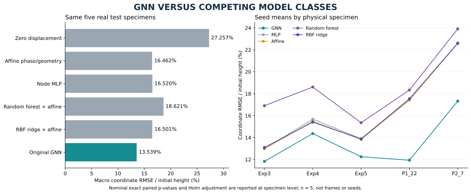
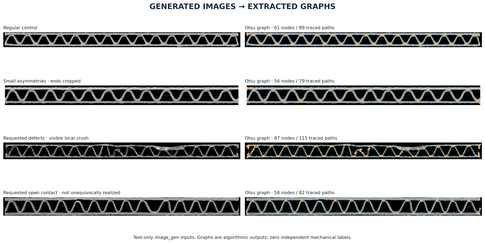
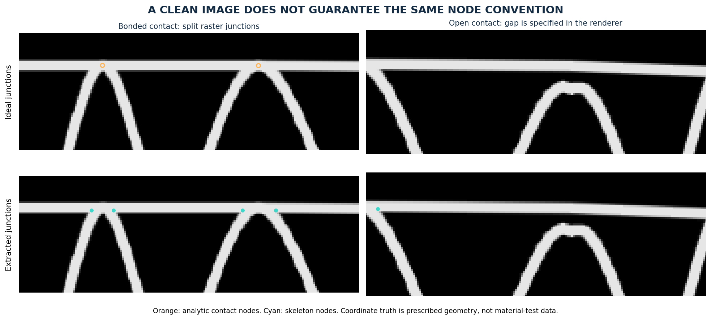
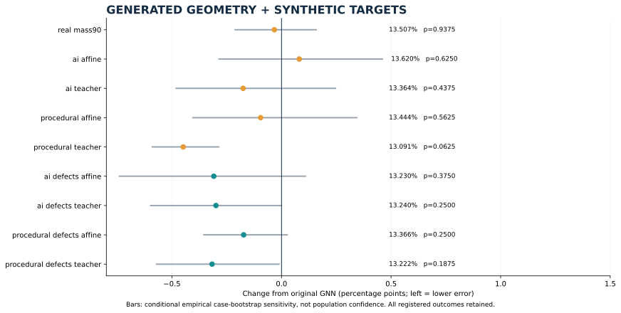
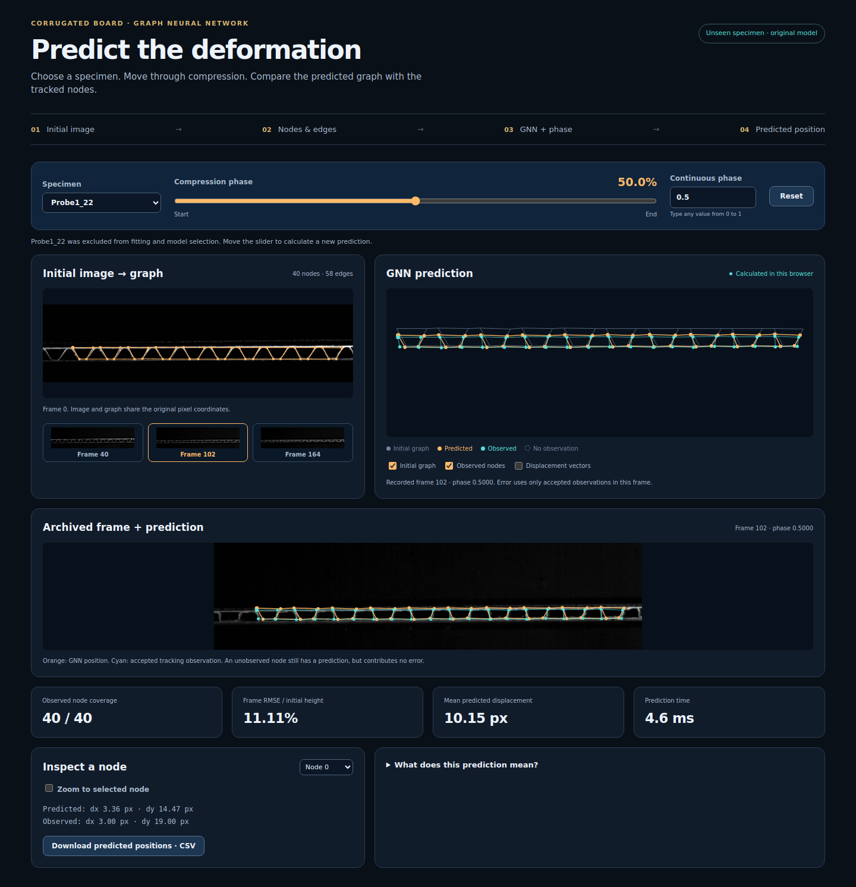

# Generated images, geometric defects and competing model classes

Study date: 2026-10-10. **Exploratory follow-up; original benchmark retained.**
The registered source is commit `e84cf7e54943c9e1901f1acbc059160dc645670d`, created
before any new real-data model fitting. The preserved source PNG hashes are in
[`protocol.json`](../results/synthetic_images/protocol.json). Earlier benchmark
and diagnostic outcomes were already known: these five cases are reused tests,
not a newly untouched prospective external study.

## What was actually executed

- **Four native generated photographs**, two roughly regular controls and two
  requested to emphasize geometric defects; all original PNGs and exact prompts retained.
- **168 new analytical raster frames**, from regular/defective 14/18-wave
  geometries, two appearances and 21 phases. Both fixed and Otsu extraction:
  **336 rendered-frame extraction calls**, plus both thresholds on four native images.
- **135 GNN fits:** eight synthetic interventions and one reduced-real-loss
  control, each on the unchanged five folds and three seeds.
- **30 selected competing-model fits:** Random Forest and RBF ridge across
  the same five folds/three seeds. Selection evaluates three RF configurations
  and nine RBF configurations per fold/seed (**180 fitted candidates**).
- Every new test prediction is scored with the original frame IDs and masks;
  all 135 GNN checkpoints reproduce their saved predictions exactly.
- The full integrity suite passes **66 tests**, without failures, errors or skips;
  see `results/synthetic_images/unit_tests.json`.
- A working browser GNN demonstration, with real images and graphs, was
  verified against PyTorch and handed to ORION for ProjectHub integration.

No generative transformer was trained on these five specimens. The native image
tool supplies pretrained image generation; its internal model/seed are not exposed.
The saved PNG bytes make downstream tests reproducible. **Zero new independent
mechanical observations were created.** Renderer labels are prescribed kinematics;
affine/teacher supervision is generated model output, not physical measurement.

## GNN versus competing model classes — primary statistical comparison

| Model | RMSE / initial height | GNN − competitor, pp | Nominal paired p | Holm p (5 models) |
|---|---:|---:|---:|---:|
| Zero displacement | 27.257162% ± 0.000000 | -13.717860 | 0.0625 | 0.3125 |
| Affine phase/geometry | 16.461987% ± 0.000000 | -2.922685 | 0.0625 | 0.3125 |
| Node MLP | 16.519852% ± 0.075907 | -2.980549 | 0.0625 | 0.3125 |
| Random forest + affine prior | 18.621437% ± 0.063321 | -5.082134 | 0.0625 | 0.3125 |
| RBF ridge + affine prior | 16.501461% ± 0.038415 | -2.962159 | 0.0625 | 0.3125 |
| Original GNN | 13.539302% ± 0.357173 | — | — | — |

The ± values are SD of the three macro seed scores, not confidence intervals.
All competitors have the same three real fitting specimens, one complete
validation specimen and one complete test specimen. The original MLP has 22,570
parameters; the GNN has 21,634. The Random Forest and RBF models use the same
local four inputs as the MLP (centered x/y, phase, phase²) and the same real-fit
affine prior. Their residual fitting weights each physical training specimen
equally, irrespective of frame count or missingness. RBF feature normalization
uses fitting data only. Neither new competitor is given synthetic labels.

The RF search fixes 64 trees and max depth 16, selecting leaf size 8/32/128.
RBF ridge uses 128 random Fourier features, gamma 0.125/0.5/2 and regularization
0.0001/0.001/0.01. The complete candidate grids and validation scores are retained.
This is a finite comparison, not evidence that every possible RF/kernel/transformer
configuration has been beaten. Library behavior follows the official
[RandomForestRegressor](https://scikit-learn.org/stable/modules/generated/sklearn.ensemble.RandomForestRegressor.html),
[RBFSampler](https://scikit-learn.org/stable/modules/generated/sklearn.kernel_approximation.RBFSampler.html)
and [Ridge](https://scikit-learn.org/stable/modules/generated/sklearn.linear_model.Ridge.html)
APIs; the executed scikit-learn version is 1.8.0.



**No population-level statistical significance is established.** The primary
p-values compare the original GNN with other model classes, not with its own
ablations. Seed scores are averaged within each physical test case before an
exact two-sided paired sign-flip enumeration (32 assignments). With five nonzero
differences, the smallest attainable two-sided p is 0.0625. Shared LOSO training
also makes the independent-sign assumption unverified. Frames, nodes, image
variants and optimizer seeds must not inflate the sample size.

Holm adjusts the five primary class comparisons. Conditional empirical case
bootstrap intervals enumerate all 5^5 ordered resamples; they quantify sensitivity
to these five cases/fitted models. They are **not calibrated population confidence
intervals**. Such an interval may exclude zero while the exact two-sided p remains
0.0625; those two procedures are not inversions of each other. All effects,
intervals, per-case deltas and secondary comparisons are in
[`statistics.json`](../results/synthetic_images/statistics.json).

## Defects, observations and input geometry



The defect-focused prompt requests uneven flute pitch/height, leaning webs,
local crush and an unbonded contact. The first defective image visibly contains
crushed and leaning regions. The second does **not unequivocally realize the
requested open contact**; it is kept and flagged rather than silently relabelled.
The asymmetric control also crops the object at its left/right borders. Image
appearance is neither a certified defect class nor a displacement field.

The analytical renderer supplies controlled defects: a fixed pitch perturbation,
lean, a local **28% reduction of height**, and a **12 px open upper contact** in
the 18-wave geometry. Its 21-frame compression trajectory reduces height by
35% and increases width by 2%, by construction. Appearance perturbations add
fixed-stream lighting variation, Gaussian blur and noise. These are image-pipeline
stress tests, not a constitutive or FEM simulation.

| Initial geometry | Nodes | Simple edges | Width/height | Degree counts |
|---|---:|---:|---:|---|
| Exp3 | 46 | 67 | 26.538 | 2: 4, 3: 42 |
| Exp4 | 48 | 71 | 27.390 | 2: 2, 3: 46 |
| Exp5 | 42 | 61 | 18.857 | 2: 4, 3: 38 |
| Probe1_22 | 40 | 58 | 22.795 | 2: 4, 3: 36 |
| Probe2_7 | 44 | 64 | 24.024 | 2: 4, 3: 40 |
| ai_regular_x1.0 | 61 | 89 | 22.561 | 1: 3, 3: 57, 4: 1 |
| ai_asymmetric_x1.0 | 56 | 79 | 14.957 | 1: 5, 3: 51 |
| analytic14_defectFalse_x1.0 | 31 | 57 | 20.000 | 2: 2, 4: 27, 1: 2 |
| analytic18_defectFalse_x1.0 | 39 | 73 | 20.000 | 2: 2, 4: 35, 1: 2 |
| ai_crushed_x1.0 | 87 | 113 | 17.891 | 1: 16, 3: 66, 2: 4, 4: 1 |
| ai_contact_requested_x1.0 | 58 | 82 | 15.491 | 1: 6, 4: 2, 3: 50 |
| analytic14_defectTrue_x1.0 | 31 | 57 | 20.014 | 2: 2, 4: 27, 1: 2 |
| analytic18_defectTrue_x1.0 | 38 | 70 | 20.014 | 2: 2, 4: 32, 3: 2, 1: 2 |

The native defect image has many more extracted junctions than the original
specimens. The 87-node crush graph has 115 traced material paths but only 113
unique simple adjacencies. Width/height, node count, degree and representation
conventions therefore change together; this is not a perfectly geometry-matched
causal comparison. Every family has four fixed horizontal stretches
(0.9, 1, 1.1, 1.2), and eight graphs total. Their full descriptors and source
checks are retained in the geometry bank and representation audit.

| Geometry | Appearance | Threshold | Tracking coverage | Warp endpoint RMSE, px | Strict ideal-node F1 |
|---|---|---|---:|---:|---:|
| Regular | Clean | fixed | 100.000% | 1.572 | 0.120 |
| Regular | Clean | otsu | 100.000% | 1.515 | 0.098 |
| Regular | Blur/lighting/noise | fixed | 99.123% | 1.781 | 0.115 |
| Regular | Blur/lighting/noise | otsu | 100.000% | 1.565 | 0.112 |
| Defective | Clean | fixed | 98.872% | 1.712 | 0.226 |
| Defective | Clean | otsu | 100.000% | 1.645 | 0.233 |
| Defective | Blur/lighting/noise | fixed | 99.871% | 1.958 | 0.238 |
| Defective | Blur/lighting/noise | otsu | 100.000% | 1.648 | 0.232 |

Values average the 14/18-wave sequence results equally. Tracking coverage and
endpoint error are evaluated against the known warp at **all frame-0 extracted
proxy nodes**, using the pipeline's actual validity masks. Endpoint error is
2D Euclidean RMSE in pixels, not the GNN coordinate RMSE metric. It is conditional
on tracked proxies and must be read together with coverage. Otsu is the fixed
training-graph extraction choice, declared before GNN fits; no test score chooses
the threshold.

The strict ideal-node F1 uses a 12-pixel one-to-one gate and the original ambiguity
rejection. Its low value exposes a representation mismatch: a single ideal
tangential contact frequently becomes **two degree-3 skeleton junctions**,
rather than one contact node. Therefore it is not a calibrated measure of
physical node-tracking accuracy. Complete strict node/edge scores and per-frame
matches, including failures, remain in `image_audit.json`.



An additional exact representation probe changes the interior free-flute path
by **12 px** while preserving all node coordinates and the simple adjacency.
The original model produces **identical predictions** (2,508 coordinates;
maximum difference 0). The defective analytic graph has 71 material paths but
only 70 unique adjacencies: an unbonded flute and a liner can connect the same
pair of nodes. The GNN's straight endpoint edge features discard this parallel
path and its curvature. Interior gap/curvature changes with unchanged endpoints
are consequently **unidentifiable from the current inputs**. This is a demonstrated
architecture/input limitation, not proof that it caused the earlier video-data
regression. See `representation_audit.json`.

## Controlled augmentation: do the images help the original task?

The eight arms factor geometry source (native image versus analytic), regular
versus defect-requested shape, and synthetic target source (affine versus frozen
original GNN teacher). Each update assigns 0.9 loss mass to the three real
specimens and 0.1 to one synthetic graph, cycling a fixed seeded permutation.
All 33 equally spaced synthetic phases are used. The extra `real_mass90` control
scales real supervision by 0.9 without synthetic loss. It checks whether a result
can be attributed merely to changing the supervised gradient scale.

The affine coefficients and residual normalization are fitted **only on the
three real training specimens**. A teacher is the original checkpoint from the
same fold and seed, with its fit/validation/test metadata checked before use.
No pseudo-label comes from a model fitted on that fold's held-out specimen.
Real missing observations remain masked; no fill-forward, interpolation, or
synthetic revival of an unobserved real target is permitted. The original whole
validation specimen selects the epoch, including epoch zero. The original test
mask, phases and normalization are unchanged.

| Registered arm | RMSE / height | Δ vs original, pp | Nominal p | Holm p (9 arms) |
|---|---:|---:|---:|---:|
| `real_mass90` | 13.506591% ± 0.294540 | -0.032711 | 0.9375 | 1.0000 |
| `ai_affine` | 13.620414% ± 0.137376 | +0.081112 | 0.6250 | 1.0000 |
| `ai_teacher` | 13.364166% ± 0.147807 | -0.175136 | 0.4375 | 1.0000 |
| `procedural_affine` | 13.443871% ± 0.157451 | -0.095432 | 0.5625 | 1.0000 |
| `procedural_teacher` | 13.090758% ± 0.139525 | -0.448544 | 0.0625 | 0.5625 |
| `ai_defects_affine` | 13.230215% ± 0.071555 | -0.309087 | 0.3750 | 1.0000 |
| `ai_defects_teacher` | 13.240040% ± 0.210714 | -0.299262 | 0.2500 | 1.0000 |
| `procedural_defects_affine` | 13.366474% ± 0.172718 | -0.172828 | 0.2500 | 1.0000 |
| `procedural_defects_teacher` | 13.222228% ± 0.101257 | -0.317074 | 0.1875 | 1.0000 |



For example, `procedural_teacher` changes error by -0.448544 pp
(-3.313% relative), with a conditional case interval
[-0.589748, -0.286324] pp and nominal p = 0.0625.
This is an exploratory regularization/distillation result. It does not validate
synthetic mechanical labels or replace the original benchmark.

The same arm also improves on the `real_mass90` control by 0.415833 pp, in all
five seed-averaged specimens (nominal p = 0.0625; Holm p = 0.5 across eight
synthetic-versus-mass-control contrasts). In this run its reduction cannot be
explained solely by reducing the real supervised loss from 1.0 to 0.9. This
remains conditional evidence from these models/cases, not population significance.

| Defect-requested minus regular | Δ RMSE, pp | Nominal p | Holm p (4 contrasts) |
|---|---:|---:|---:|
| ai_affine | -0.390199 | 0.0625 | 0.2500 |
| ai_teacher | -0.124127 | 0.5000 | 1.0000 |
| procedural_affine | -0.077397 | 0.9375 | 1.0000 |
| procedural_teacher | +0.131470 | 0.3125 | 0.9375 |

| Teacher minus affine synthetic targets | Δ RMSE, pp | Nominal p | Holm p (4 contrasts) |
|---|---:|---:|---:|
| ai | -0.256248 | 0.0625 | 0.2500 |
| procedural | -0.353113 | 0.0625 | 0.2500 |
| ai_defects | +0.009825 | 1.0000 | 1.0000 |
| procedural_defects | -0.144246 | 0.2500 | 0.5000 |

The matched defect comparisons change the source shapes but have the same target
mechanism, loss weight and validation rule. Native defects are neither perfectly
realized nor matched to analytic defect amplitudes, so their effects cannot be
interpreted as a calibrated defect-response experiment. The separate
`synthetic_minus_real_mass90` comparisons and all new GNN-versus-competitor
contrasts are also reported in the statistics file. No favorable arm is hidden
among unreported runs or promoted to a new primary benchmark.

## Per-specimen results

| Model/arm | Exp3 D12 | Exp4 D14 | Exp5 ID03 | Probe1_22 | Probe2_7 |
|---|---:|---:|---:|---:|---:|
| Zero displacement | 27.796% | 20.473% | 25.813% | 31.793% | 30.412% |
| Affine phase/geometry | 12.976% | 15.477% | 13.832% | 17.415% | 22.610% |
| Node MLP | 12.976% | 15.679% | 13.900% | 17.449% | 22.594% |
| Random forest + affine prior | 16.901% | 18.609% | 15.353% | 18.334% | 23.910% |
| RBF ridge + affine prior | 13.095% | 15.412% | 13.867% | 17.534% | 22.599% |
| Original GNN | 11.827% | 14.362% | 12.250% | 11.934% | 17.324% |
| `real_mass90` | 11.570% | 14.701% | 12.247% | 11.663% | 17.351% |
| `ai_affine` | 11.794% | 15.088% | 11.710% | 12.090% | 17.420% |
| `ai_teacher` | 11.490% | 14.966% | 11.620% | 11.691% | 17.055% |
| `procedural_affine` | 11.378% | 15.091% | 11.910% | 11.909% | 16.932% |
| `procedural_teacher` | 11.138% | 14.200% | 11.777% | 11.424% | 16.915% |
| `ai_defects_affine` | 10.804% | 14.754% | 11.612% | 11.942% | 17.039% |
| `ai_defects_teacher` | 11.044% | 14.602% | 11.699% | 11.762% | 17.093% |
| `procedural_defects_affine` | 11.375% | 14.508% | 11.941% | 11.936% | 17.073% |
| `procedural_defects_teacher` | 11.394% | 14.589% | 11.574% | 11.763% | 16.792% |

## Which explanations are supported?

1. **A richer image count alone is insufficient.** The generated images contain
   no measured mechanics. Their training effect depends on which graph and target
   mechanism are used, and can improve or worsen the same real tests.
2. **Graph representation is a demonstrated limitation for some defects.** Split
   junction conventions and discarded parallel/polyline paths are directly
   observed; the identical-input/different-interior-geometry probe proves a loss
   of distinguishable geometric information. It does not quantify the fraction
   of real benchmark error explained by this loss.
3. **Defect augmentation is not uniformly beneficial.** All four matched effects
   are reported above; none establishes a population-level advantage at 5%.
   Domain, topology convention, node count and generative prompt fidelity remain
   confounded in native-versus-procedural comparisons.
4. **No test-data leakage or masked-target revival is used.** Real fitting,
   validation and test identities are preserved, teacher membership is checked,
   normalization is real-fit-only, and all saved test masks/scores are audited.
5. **The earlier video regression remains multifactorial.** Prior controlled
   evidence supports sensitivity to training mixture/weights and predicted mean
   field bias, not a demonstrated tracking, phase or normalization bug. These
   generated-image experiments do not establish a new causal explanation for it.

The next informative architecture experiment is to add explicit material-path
features (arc length, curvature, local thickness where measured, contact identity)
or subdivision nodes and a multigraph, with a matched input-only comparison on
the same validation rule. A mechanics-labelled generator needs a separately
validated solver and material/boundary conditions; photorealism is not a substitute.
Both routes require a new locked physical test cohort for credible significance,
after the current exploratory choices are frozen.

## Interactive demonstration and documentation



The [demo](../web_demo/README.md) uses all five original held-out seed-11
checkpoints and shows source images, initial/predicted/observed graphs, missing
observations, node inspection and CSV export. Continuous phases without an exact
recorded frame have no displayed observation or measured error. Across 46,604
coordinates, JavaScript and PyTorch differ by at most 6.15×10⁻⁷ normalized units.
Desktop/mobile and the self-contained offline bundle pass executable checks.

The ORION request `rf-projecthub-gnn-prediction-20261010` has an immutable integration
package and receipt. Immediate execution was requested once. **ProjectHub live
deployment has not been confirmed**; ORION's combined build/content gates and
RELAY publishing remain separate from the locally verified demonstration.

## Reproduction

```bash
python -m pip install -r requirements-exploratory.txt
PYTHONPATH=. python scripts/synthetic_image_geometry.py
PYTHONPATH=. OPENBLAS_NUM_THREADS=1 OMP_NUM_THREADS=1 python scripts/train_synthetic_images.py --workers 4
PYTHONPATH=. python scripts/analyze_synthetic_images.py
PYTHONPATH=. python scripts/audit_synthetic_representation.py
PYTHONPATH=. python scripts/verify_synthetic_images.py
PYTHONPATH=. python scripts/plot_synthetic_images.py
PYTHONPATH=. python scripts/build_synthetic_report.py
python -m unittest discover -s tests -v
python scripts/bundle_web_demo.py
```

Registration refuses changed code/input/environment fingerprints. On a fresh
clone, fitting regenerates numerical checkpoints/predictions in the ignored
`results/synthetic_images/cache/`; it does not treat a compact JSON score as a
usable checkpoint. Source photos, geometry bank, protocol, every selected run's
validation history/grid, aggregate results and audits are versioned. The original
data, checkpoints and benchmark results are preserved.
